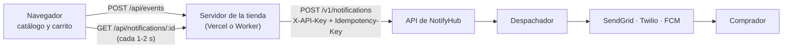

# Tienda de demostración

Tienda en línea mínima que usa NotifyHub como su módulo de notificaciones. Muestra a NotifyHub dentro de un
e-commerce, como en los diagramas de contexto y casos de uso: cada evento de un pedido (pedido confirmado, pago
rechazado, envío en camino, pedido entregado) se convierte en un `POST /v1/notifications` y el comprador recibe
el aviso por el canal que eligió.

- **En producción:** <https://notifyhub-demo-store.vercel.app> (Vercel), conectada a la API de NotifyHub en
  Cloudflare con su propio cliente, `Tienda Demo (Vercel)`.
- **En local:** con `pnpm demo:local`, como Worker de Cloudflare en <http://localhost:8790>.



La API key vive solo en el servidor de la tienda; el navegador nunca la ve.

## Código

| Archivo                    | Qué hace                                                                                                |
| -------------------------- | ------------------------------------------------------------------------------------------------------- |
| `src/events.ts`            | Traduce cada evento del pedido a una solicitud de NotifyHub (plantillas, prioridad, `Idempotency-Key`). |
| `src/app.ts`               | Rutas: `GET /`, `POST /api/events` y `GET /api/notifications/:id`. Igual en Cloudflare y en Vercel.     |
| `src/page.ts`              | La tienda: catálogo, carrito, datos del comprador y avisos en vivo (HTML y JS sin dependencias).        |
| `src/index.ts`             | Entrada para Cloudflare Workers (local).                                                                |
| `src/vercel.ts`            | Entrada para Vercel Functions (producción).                                                             |
| `scripts/build-vercel.mjs` | Empaqueta `src/vercel.ts` con el SDK en `vercel/api/index.js`, sin depender del monorepo.               |
| `scripts/rotate-key.sh`    | Rota la API key de la tienda en Neon y en Vercel e imprime la nueva para conectar la consola.           |
| `test/events.test.ts`      | Plantillas, prioridades, llave de idempotencia y validación de la solicitud.                            |

Cada evento usa como `Idempotency-Key` `<pedido>:<evento>` (por ejemplo `PED-ABC123:order.confirmed`): si la
tienda reintenta, NotifyHub devuelve el aviso original en lugar de mandar otro. Se envían correo, teléfono y token
de push juntos para que NotifyHub pueda cambiar de canal si el preferido falla.

| Evento             | Aviso             | Prioridad |
| ------------------ | ----------------- | --------- |
| `order.confirmed`  | Pedido confirmado | MEDIUM    |
| `payment.rejected` | Pago rechazado    | HIGH      |
| `order.shipped`    | Envío en camino   | MEDIUM    |
| `order.delivered`  | Pedido entregado  | LOW       |

## Local

```bash
pnpm demo:local   # Postgres, API + despachador (8787), consola (4321) y tienda (8790)
```

Abre <http://localhost:8790>. `demo:local` copia `.dev.vars.example` a `.dev.vars` (la llave `nh_dev_local_key`
del seed) y deja `SIMULATED_PROVIDERS=true` en `apps/dispatcher/.dev.vars`, para que el despachador use los
proveedores simulados aunque no haya credenciales de SendGrid ni Twilio.

## Producción (Vercel)

La tienda es un proyecto de Vercel, `notifyhub-demo-store`, publicado desde la carpeta `vercel/` con la CLI:

```bash
cd apps/demo-store/vercel && vercel link --project notifyhub-demo-store && cd -   # solo la primera vez
pnpm --filter @notifyhub/demo-store deploy:vercel   # empaqueta y publica en producción
```

Variables del proyecto en Vercel (Production):

| Variable            | Valor                                                |
| ------------------- | ---------------------------------------------------- |
| `NOTIFYHUB_API_URL` | `https://notifyhub-api.sc202357155.workers.dev`      |
| `NOTIFYHUB_API_KEY` | Secreto: la llave del cliente `Tienda Demo (Vercel)` |
| `CONSOLE_URL`       | `https://notifyhub-console.sc202357155.workers.dev`  |
| `STORE_NAME`        | `Tienda Demo`                                        |

En NotifyHub cada API key solo ve sus propias notificaciones. Para ver las de la tienda en la consola, conéctala
con la llave de la tienda. Como Vercel no deja leer un secreto, la forma de obtenerla es rotarla:

```bash
bash apps/demo-store/scripts/rotate-key.sh   # requiere neonctl y vercel con sesión iniciada
```

## Guion para la demostración

1. **Compra normal.** Escribe tu nombre, correo y teléfono, agrega productos, elige "Correo electrónico" y paga.
   Aparece el aviso "Pedido confirmado" y pasa a **Entregado**.
2. **Fallback.** En la consola, en "Proveedores y ruteo", marca FCM como `DOWN`. Haz otra compra eligiendo
   "Notificación push": el aviso hace 3 intentos por push y NotifyHub **cambia de canal** a SMS. Vuelve a poner
   FCM en `UP` al terminar.
3. **Idempotencia.** Pulsa "Repetir confirmación". La tienda manda la misma `Idempotency-Key` y NotifyHub devuelve
   el aviso original marcado **Duplicado evitado**: el comprador no recibe dos avisos.
4. **Eventos del back office.** "Pago rechazado" sale con prioridad alta; "Marcar como enviado" y
   "Marcar como entregado" siguen el ciclo del pedido.
5. **Trazabilidad.** "Ver en la bitácora" abre la consola filtrada por esa notificación (con la consola conectada
   con la llave de la tienda).
