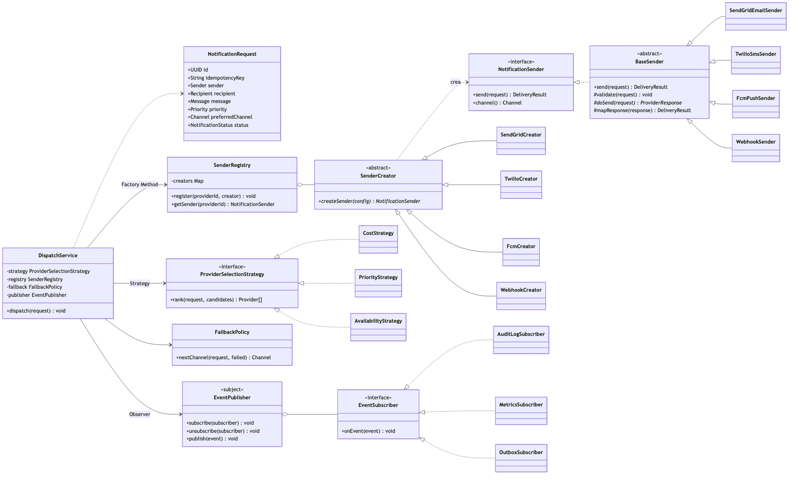

# apps/dispatcher

Worker consumidor de Cloudflare Queues (`notifications-high`, `-medium`, `-low`). Toma cada notificación encolada por la API y la entrega: pide a la **Strategy** el orden de proveedores, obtiene el emisor de la **factoría**, reintenta con backoff y, si se agota el canal, hace el **fallback** al siguiente. Cada cambio de estado se publica como evento (**Observer**).

Historias: SCRUM-27 (emisor y Template Method), SCRUM-28 (Factory Method), SCRUM-33 (worker despachador), SCRUM-34 (Strategy) y SCRUM-35 (fallback).



## Dónde está cada pieza

| Pieza                                                | Código                                                           |
| ---------------------------------------------------- | ---------------------------------------------------------------- |
| Worker (cola → servicio)                             | `apps/dispatcher/src/index.ts`                                   |
| Orquestación: estados, reintentos, fallback          | `packages/application/src/dispatch/dispatch-service.ts`          |
| Strategy: costo, prioridad, disponibilidad           | `packages/application/src/dispatch/strategies.ts`                |
| Factory Method: `SenderCreator` y `SenderRegistry`   | `packages/application/src/dispatch/sender-creator.ts`            |
| Observer: `EventPublisher`                           | `packages/application/src/dispatch/event-publisher.ts`           |
| Template Method: `BaseSender` y los cuatro emisores  | `packages/providers/src/`                                        |
| Reglas por defecto (igual que `config/routing.yaml`) | `packages/application/src/dispatch/routing-config.ts`            |
| Límite global por proveedor y vista en vivo          | Postgres `provider_dispatch_lease` + `GET /v1/dispatch/capacity` |

## Proveedores simulados

Los emisores usan un **transporte simulado** cuyo comportamiento sale de la salud del proveedor (`provider.health`): `UP` entrega, `DEGRADED` falla la mitad de las veces y es lento, `DOWN` responde siempre `503`. Los adaptadores reales de SendGrid, Twilio, FCM y webhook (SCRUM-29 a SCRUM-32) sustituyen el transporte sin tocar el despachador.

## Probar el fallback en local

```bash
pnpm infra:up                      # Postgres
# en otra terminal, desde apps/api: la API y el despachador juntos comparten las colas locales
npx wrangler dev -c wrangler.jsonc -c ../dispatcher/wrangler.jsonc

# Marca FCM como caído y manda un push: tres intentos 503, FALLBACK y entrega por SMS.
docker exec notifyhub-postgres-1 psql -U notifyhub -d notifyhub -c "UPDATE provider SET health='DOWN' WHERE code='fcm'"
```

## Concurrencia y reintentos

Cada lote procesa hasta tres mensajes en paralelo con una conexión PostgreSQL independiente por mensaje. Las
concesiones FIFO guardadas en Postgres imponen límites compartidos entre instancias/colas: SendGrid 3, Twilio 2,
FCM 5 y webhook 2. Un envío de proveedor expira en 30 s y su concesión en 45 s; las filas activas y esperas
abandonadas vencen y se limpian en la siguiente adquisición. Los reintentos de cola vuelven a reclamar estados
no terminales inactivos durante 120 s. Los adaptadores de proveedor deben propagar la clave idempotente estable
`<notificationId>:<provider>` al API externo.

La consola puede consultar `GET /v1/dispatch/capacity` (requiere `X-API-Key`) para ver límite, activos y
esperas por proveedor, incluidos el identificador de notificación y la cola. Los límites son de solo lectura.
Antes de desplegar ambos Workers, aplica la migración `20261101230000_dispatch_capacity` a Postgres.

## Límites del MVP

- Sin circuit breaker por proveedor (SCRUM-36) ni health checks activos (SCRUM-37).
- Sin cola de mensajes fallidos (dead-letter) para los mensajes que agotan sus reintentos de Queues.
