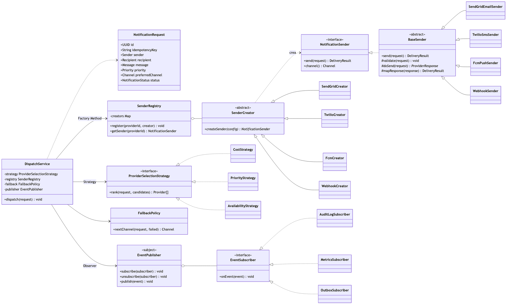

# apps/dispatcher

Worker consumidor de Cloudflare Queues (`notifications-high`, `-medium`, `-low`). Toma cada notificación encolada por la API y la entrega: pide a la **Strategy** el orden de proveedores, obtiene el emisor de la **factoría**, reintenta con backoff y, si se agota el canal, hace el **fallback** al siguiente. Cada cambio de estado se publica como evento (**Observer**).

Historias: SCRUM-27 (emisor y Template Method), SCRUM-28 (Factory Method), SCRUM-33 (worker despachador), SCRUM-34 (Strategy) y SCRUM-35 (fallback).



## Dónde está cada pieza

| Pieza                                                | Código                                                           |
| ---------------------------------------------------- | ---------------------------------------------------------------- |
| Worker (cola → servicio)                             | `apps/dispatcher/src/index.ts`                                   |
| Orquestación: estados, reintentos, fallback          | `packages/application/src/dispatch/dispatch-service.ts`          |
| Strategy: costo, prioridad, disponibilidad           | `packages/application/src/dispatch/strategies.ts`                |
| Factory Method: `SenderCreator` y `SenderRegistry`   | `packages/application/src/dispatch/sender-creator.ts`            |
| Observer: `EventPublisher`                           | `packages/application/src/dispatch/event-publisher.ts`           |
| Template Method: `BaseSender` y los cuatro emisores  | `packages/providers/src/`                                        |
| Reglas por defecto (igual que `config/routing.yaml`) | `packages/application/src/dispatch/routing-config.ts`            |
| Límite global por proveedor y vista en vivo          | Postgres `provider_dispatch_lease` + `GET /v1/dispatch/capacity` |

## Envíos reales

En producción, el Worker usa SendGrid para correo y Twilio para SMS. Configura los secretos/valores del Worker `notifyhub-dispatcher` después de crear las cuentas y verificar el remitente:

| Variable              | Tipo                    | Uso                                        |
| --------------------- | ----------------------- | ------------------------------------------ |
| `SENDGRID_API_KEY`    | Secreto                 | API key de Mail Send                       |
| `SENDGRID_FROM_EMAIL` | Secreto/valor protegido | Dirección remitente verificada en SendGrid |
| `SENDGRID_FROM_NAME`  | Secreto/valor protegido | Nombre visible, opcional                   |
| `TWILIO_ACCOUNT_SID`  | Secreto                 | SID de la cuenta Twilio                    |
| `TWILIO_AUTH_TOKEN`   | Secreto                 | Token de autenticación Twilio              |
| `TWILIO_FROM_NUMBER`  | Secreto/valor protegido | Número emisor habilitado en Twilio         |

Agrega todos los valores en **Workers & Pages → notifyhub-dispatcher → Settings → Variables and Secrets** y despliega una sola vez cuando estén completos. También puedes usar `wrangler secret bulk` con una entrada protegida; evita ejecutar `secret put` varias veces porque cada llamada despliega inmediatamente una versión parcialmente configurada. No pongas estas credenciales en `wrangler.jsonc`, en el repositorio ni en el chat.

El API de SendGrid y la API de mensajes de Twilio aceptan el envío; NotifyHub marca esas solicitudes como `SENT`, no como entrega final confirmada. La confirmación de entrega requiere configurar callbacks/webhooks de estado, que todavía no están implementados. Los canales FCM y webhook genérico se bloquean en este registro de producción hasta que tengan un adaptador real; el transporte simulado queda disponible solo en pruebas.

La cola tiene semántica de al menos una vez: si el Worker cae después de que el proveedor acepte un mensaje y antes de guardar el resultado, puede volver a enviarlo. La clave idempotente interna no elimina ese riesgo porque estos adaptadores aún no tienen deduplicación confirmada en el proveedor.

## Proveedores simulados

Las pruebas pueden usar el **transporte simulado** cuyo comportamiento sale de la salud del proveedor (`provider.health`): `UP` entrega, `DEGRADED` falla la mitad de las veces y es lento, `DOWN` responde siempre `503`. El despachador de producción no usa este transporte para reportar envíos exitosos ficticios.

## Probar el fallback en local

```bash
pnpm infra:up                      # Postgres
# en otra terminal, desde apps/api: la API y el despachador juntos comparten las colas locales
npx wrangler dev -c wrangler.jsonc -c ../dispatcher/wrangler.jsonc -c ../event-relay/wrangler.jsonc -c ../webhook-inbox/wrangler.jsonc

# Marca FCM como caído y manda un push: tres intentos 503, FALLBACK y entrega por SMS.
docker exec notifyhub-postgres-1 psql -U notifyhub -d notifyhub -c "UPDATE provider SET health='DOWN' WHERE code='fcm'"
```

## Concurrencia y reintentos

Cada lote procesa hasta tres mensajes en paralelo con una conexión PostgreSQL independiente por mensaje. Las
concesiones FIFO guardadas en Postgres imponen límites compartidos entre instancias/colas: SendGrid 3, Twilio 2,
FCM 5 y webhook 2. Un envío de proveedor expira en 30 s y su concesión en 45 s; las filas activas y esperas
abandonadas vencen y se limpian en la siguiente adquisición. Los reintentos de cola vuelven a reclamar estados
no terminales inactivos durante 120 s. Los adaptadores de proveedor deben propagar la clave idempotente estable
`<notificationId>:<provider>` al API externo.

La consola puede consultar `GET /v1/dispatch/capacity` (requiere `X-API-Key`) para ver límite, activos y
esperas por proveedor, incluidos el identificador de notificación y la cola. Los límites son de solo lectura.
Antes de desplegar ambos Workers, aplica la migración `20261101230000_dispatch_capacity` a Postgres.

## Límites del MVP

- Sin circuit breaker por proveedor (SCRUM-36) ni health checks activos (SCRUM-37).
- Sin cola de mensajes fallidos (dead-letter) para los mensajes que agotan sus reintentos de Queues.
