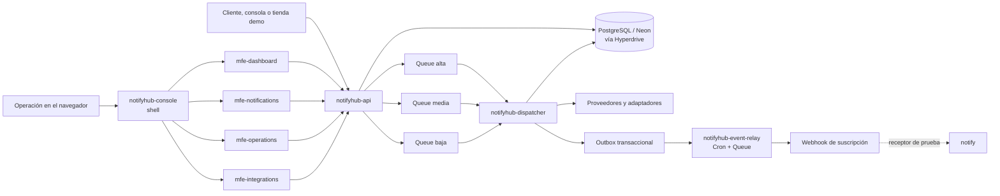

# Arquitectura actual de NotifyHub

**Actualizado:** 25 de noviembre de 2026  
**Fuente de verdad:** el código de `apps/`, los paquetes de `packages/` y las configuraciones `wrangler.jsonc`.

## Respuesta corta

NotifyHub está dividido en servicios backend y microfrontends desplegables. La descripción más precisa actualmente es:

> **Monorepo modular con backend serverless y microfrontends por dominio funcional.**

El backend sigue siendo distribuido/serverless y comparte PostgreSQL/Neon y paquetes de dominio. El frontend sí aplica
una separación por microfrontends: cada módulo tiene su propia aplicación Astro, build, Worker y ciclo de despliegue.

## Unidades desplegables

| Unidad                                       | Tipo                               | Responsabilidad                                                                                       | Exposición                     |
| -------------------------------------------- | ---------------------------------- | ----------------------------------------------------------------------------------------------------- | ------------------------------ |
| `apps/api` · `notifyhub-api`                 | Worker de entrada                  | API HTTP Hono, autenticación por API key, idempotencia, persistencia y publicación en Queues          | Pública                        |
| `apps/dispatcher` · `notifyhub-dispatcher`   | Worker consumidor                  | Consume las colas por prioridad, elige proveedor/canal, reintenta, hace fallback y registra auditoría | Interna; sin URL de negocio    |
| `apps/event-relay` · `notifyhub-event-relay` | Worker programado + consumidor     | Lee el outbox, publica entregas de webhook y reintenta los envíos                                     | Interna; Cron cada minuto      |
| `apps/webhook-inbox` · `notify`              | Worker receptor                    | Recibe un webhook de prueba, verifica HMAC-SHA256 contra la suscripción y registra metadatos          | Pública: `/notify` y `/health` |
| `apps/console` · `notifyhub-console`         | Shell frontend                     | Barra lateral, conexión y composición de módulos remotos mediante `iframe` + `postMessage`            | Pública                        |
| `apps/mfe-dashboard`                         | Microfrontend Astro                | Resumen: mapa de rutas, actividad reciente, en curso y salud de proveedores                           | Worker público independiente   |
| `apps/mfe-notifications`                     | Microfrontend Astro                | Lista con filtros y detalle de la ruta (`/`) y nueva solicitud con fallback e idempotencia (`/nueva`) | Worker público independiente   |
| `apps/mfe-operations`                        | Microfrontend Astro                | Proveedores, capacidad y ruteo (`/`) y bitácora de auditoría con exportación (`/bitacora`)            | Worker público independiente   |
| `apps/mfe-integrations`                      | Microfrontend Astro                | Suscripciones y destinos webhook firmados                                                             | Worker público independiente   |
| `apps/demo-store` · `notifyhub-demo-store`   | Aplicación cliente de demostración | Simula una tienda que llama a `POST /v1/notifications`; no forma parte del núcleo de NotifyHub        | Opcional; local o Vercel       |

`apps/api`, `apps/dispatcher`, `apps/event-relay` y `apps/webhook-inbox` son los servicios runtime del backend.
`apps/console` es el shell y los cuatro `apps/mfe-*` son los microfrontends. Los proveedores de correo/SMS/Push/Webhook
son adaptadores del dispatcher, no servicios propios de este repositorio.

## Paquetes compartidos

Los servicios no duplican la lógica de negocio: la consumen desde el monorepo.

| Paquete                | Función                                                               |
| ---------------------- | --------------------------------------------------------------------- |
| `packages/domain`      | Entidades, estados, eventos y reglas sin infraestructura              |
| `packages/application` | Casos de uso, puertos, despacho, Strategy, Factory Method y Observer  |
| `packages/persistence` | Prisma, migraciones y repositorios PostgreSQL                         |
| `packages/providers`   | Emisores y adaptadores de proveedores                                 |
| `packages/shared`      | Configuración y tipos compartidos                                     |
| `packages/client`      | SDK TypeScript para consumidores de la API                            |
| `packages/ui`          | Componentes React de notificaciones, rutas y tokens de diseño         |
| `packages/mfe-runtime` | Kit del shell y los MFEs: primitivas, estilos, conexión, demo, puente |

La carpeta `version-2/` es un proyecto independiente de TaskFlow y **no pertenece al runtime actual de NotifyHub ni al
workspace principal**.

## Flujo de ejecución

1. `notifyhub-api` valida la solicitud, la guarda y responde `202 Accepted` después de encolarla.
2. `notifyhub-dispatcher` consume una de las tres colas, ejecuta reintentos y cambia de canal cuando corresponde.
3. Los cambios de estado y los intentos se escriben en `outbox_event` dentro de la transacción correspondiente.
4. `notifyhub-event-relay` publica los eventos pendientes en `webhook-deliveries`, crea entregas idempotentes por
   suscripción y hace los POST firmados.
5. `notify` permite probar el receptor: valida firma, tipo de evento, UUID y tamaño del cuerpo, y responde `204`.

## Cómo se componen el shell y los microfrontends

La consola dejó de ser una única aplicación UI. El shell (`apps/console`) solo conserva la barra lateral, la ruta y el
estado de conexión; cada dominio funcional vive en una aplicación independiente con su propio build y Worker.

| Ruta del shell    | Microfrontend       | Ruta dentro del MFE |
| ----------------- | ------------------- | ------------------- |
| `/`               | `mfe-dashboard`     | `/`                 |
| `/notificaciones` | `mfe-notifications` | `/`                 |
| `/nueva`          | `mfe-notifications` | `/nueva`            |
| `/proveedores`    | `mfe-operations`    | `/`                 |
| `/bitacora`       | `mfe-operations`    | `/bitacora`         |
| `/suscripciones`  | `mfe-integrations`  | `/`                 |

**Un solo diseño.** `@notifyhub/mfe-runtime` es el kit que comparten el shell y los cuatro MFEs: primitivas de interfaz
(`@notifyhub/mfe-runtime/ui/*`), tokens y tipografías (`styles.css` y `MfeDocument.astro`), piezas de página
(`PageHeader`, `FilterSelect`, panel de detalle) y la conexión. Cada MFE solo contiene las pantallas de su dominio, así
que un cambio de diseño se hace una vez y llega a todos. Embebido, el MFE no pinta cabecera propia; abierto suelto, pinta
una cabecera mínima con la misma identidad y su propio botón de conexión.

**Contrato del puente (`packages/mfe-runtime/src/lib/bridge.ts`).** Cada lado valida la ventana y el origen que envía.

| Mensaje                | Dirección   | Para qué                                                                 |
| ---------------------- | ----------- | ------------------------------------------------------------------------ |
| `notifyhub:mfe-ready`  | MFE → shell | El MFE cargó; el shell le responde con la conexión                       |
| `notifyhub:connection` | shell → MFE | Conexión activa (demo o API real con su key); nunca viaja en la URL      |
| `notifyhub:mfe-height` | MFE → shell | Alto del contenido: el iframe crece con la página, sin scroll propio     |
| `notifyhub:navigate`   | MFE → shell | Ir a otra ruta del shell (solo rutas internas que empiezan con `/`)      |
| `notifyhub:rpc`        | MFE → shell | Solo en modo demo: llamada a un método de la lista cerrada `RPC_METHODS` |
| `notifyhub:rpc-result` | shell → MFE | Respuesta o error (`NotifyHubError` serializado) de esa llamada          |

**Datos.** Conectado a la API real, cada MFE llama directamente a la API con el SDK `@notifyhub/client` (con CORS
explícito para su origen). En modo demo, el cliente demo vive en el shell y los MFEs embebidos le delegan las
llamadas: como cada MFE está en otro origen y no comparte `sessionStorage`, así una solicitud creada en «Nueva
solicitud» aparece en Resumen, Notificaciones y Bitácora.

**Enlaces.** Las pantallas enlazan siempre a rutas del shell (`shellLink`, `navigateShell`). Los parámetros de la
ruta del shell, como `?notificationId=` en la bitácora, se reenvían al MFE.

Esto no convierte el backend en microservicios autónomos: API, dispatcher y relay todavía comparten PostgreSQL y
paquetes de dominio. La separación de microfrontends y la de microservicios son decisiones independientes.

## Desarrollo y despliegue de los MFEs

- `pnpm dev:console` levanta solo el frontend (shell en `http://localhost:4321` y los cuatro MFEs) en modo demo, sin
  Docker. Es lo que basta para trabajar el diseño.
- `pnpm demo:local` levanta además PostgreSQL, API, despachador y tienda demo para conectarse a la API real.

| Módulo         | URL local               | Filtro de workspace            |
| -------------- | ----------------------- | ------------------------------ |
| Shell          | `http://localhost:4321` | `@notifyhub/console`           |
| Dashboard      | `http://localhost:4331` | `@notifyhub/mfe-dashboard`     |
| Notificaciones | `http://localhost:4332` | `@notifyhub/mfe-notifications` |
| Operaciones    | `http://localhost:4333` | `@notifyhub/mfe-operations`    |
| Integraciones  | `http://localhost:4334` | `@notifyhub/mfe-integrations`  |

Cada aplicación tiene su propio `wrangler.jsonc` y Worker: `notifyhub-mfe-dashboard`,
`notifyhub-mfe-notifications`, `notifyhub-mfe-operations` y `notifyhub-mfe-integrations`. El workflow de producción
los publica antes del shell, con `PUBLIC_NOTIFYHUB_API_URL` y `PUBLIC_SHELL_URL`, y el shell recibe sus URLs en
`PUBLIC_MFE_*_URL`. Sus orígenes deben estar en `CORS_ALLOWED_ORIGINS` de la API.

## Dónde revisar cada parte

- [Guía de ejecución y arquitectura](guia-del-proyecto.md)
- [Despliegue en Cloudflare](despliegue.md)
- [Contrato OpenAPI](api/openapi.yaml)
- [ADRs y decisiones técnicas](adr/README.md)
- [Diagramas Mermaid y renders](diagrams/)
- [Workflow de despliegue](../.github/workflows/deploy.yml)
