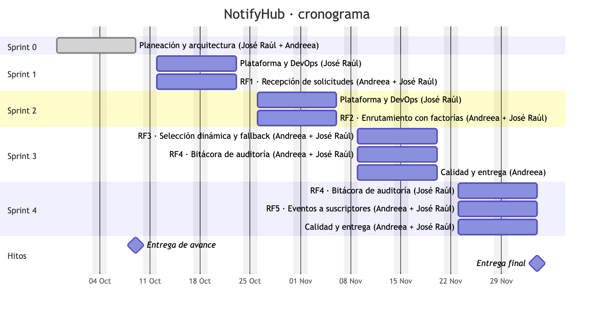

# Avance por historia

Corte: 9 de octubre de 2026. Claves: `NH-n` (planeación) = `SCRUM-(n+8)` (Jira).

## Sprint 0 · Planeación y diseño (28 sep – 9 oct)

| Jira     | Historia                        | Resp. | Estado                           | Evidencia                                                                                                                 |
| -------- | ------------------------------- | ----- | -------------------------------- | ------------------------------------------------------------------------------------------------------------------------- |
| SCRUM-9  | Alcance, RF y RNF               | JRS   | ✅                               | Descripción de la épica SCRUM-1                                                                                           |
| SCRUM-10 | Stack y ADRs                    | JRS   | ✅                               | [docs/adr](adr/README.md): ADR-001 a ADR-005                                                                              |
| SCRUM-11 | Modelo de dominio y clases GoF  | AMM   | ✅                               | [03-clases-patrones](diagrams/render/03-clases-patrones.png) · `packages/domain`                                          |
| SCRUM-12 | Modelo ER                       | AMM   | ✅                               | [04-er](diagrams/render/04-er.png) · [schema.prisma](../packages/persistence/prisma/schema.prisma)                        |
| SCRUM-13 | C4 y despliegue                 | JRS   | ✅                               | [01](diagrams/render/01-contexto.png), [02](diagrams/render/02-contenedores.png), [07](diagrams/render/07-despliegue.png) |
| SCRUM-14 | Secuencia y estados             | AMM   | ✅                               | [05](diagrams/render/05-secuencia-envio.png), [06](diagrams/render/06-estados.png) · `status-machine.ts`                  |
| SCRUM-15 | Contrato OpenAPI 3.1            | JRS   | ✅                               | [openapi.yaml](api/openapi.yaml), validado con Redocly                                                                    |
| SCRUM-16 | Cronograma y backlog            | JRS   | ✅                               | Tablero Jira · [backlog.json](planeacion/backlog.json)                                                                    |
| SCRUM-17 | Riesgos y estrategia de pruebas | AMM   | 🟡 Borrador para revisión de AMM | [riesgos-y-pruebas.md](riesgos-y-pruebas.md)                                                                              |

## Sprint 1 · Núcleo y recepción, RF1 (12 – 23 oct), adelantado

Desde el 9 oct la API corre en Cloudflare Workers ([ADR-007](adr/0007-workers-nativo.md)). Las historias de RF1 se
reimplementaron en los adaptadores nuevos; los casos de uso y sus pruebas no cambiaron.

| Jira          | Historia                                                                              | Resp. | Estado                                      | Evidencia                                                                  |
| ------------- | ------------------------------------------------------------------------------------- | ----- | ------------------------------------------- | -------------------------------------------------------------------------- |
| SCRUM-18      | Monorepo pnpm + Turborepo, TS estricto, ESLint, Prettier, Conventional Commits, Husky | JRS   | ✅                                          | `package.json`, `turbo.json`, `eslint.config.mjs`, `.husky/`               |
| SCRUM-19      | Entorno local con Docker Compose                                                      | JRS   | ✅                                          | [infra/compose.yaml](../infra/compose.yaml) + `wrangler dev`               |
| SCRUM-20      | CI en GitHub Actions                                                                  | JRS   | 🟡 Pipeline listo; falta proteger `main`    | [.github/workflows/ci.yml](../.github/workflows/ci.yml)                    |
| SCRUM-21      | `POST /v1/notifications` con validación                                               | AMM   | 🟡 Implementado; falta revisión de AMM      | `apps/api/src/app.ts`, `http/schemas.ts` · pruebas e2e                     |
| SCRUM-22      | Idempotency-Key y deduplicación (24 h)                                                | JRS   | ✅                                          | `accept-notification.ts` · índice único en BD · 4 pruebas                  |
| SCRUM-23      | Persistir y encolar por prioridad                                                     | AMM   | 🟡 Implementado; falta revisión de AMM      | `pg-notification-repository.ts`, `queues-notification-queue.ts`            |
| SCRUM-24      | API key y rate limiting                                                               | JRS   | ✅                                          | middlewares en `app.ts` · `RateLimiterObject` (Durable Object) · 401 y 429 |
| SCRUM-25      | `GET /v1/notifications/{id}`                                                          | AMM   | 🟡 Implementado; falta revisión de AMM      | estado + intentos + historial · 2 pruebas                                  |
| SCRUM-26 (S2) | Secretos y configuración por entorno                                                  | JRS   | 🟡 Parcial                                  | `vars` validadas con Zod; la conexión a Neon vive en Hyperdrive            |
| SCRUM-50      | Despliegue en Cloudflare (plan gratuito)                                              | JRS   | 🟡 Listo; falta el primer `wrangler deploy` | [despliegue.md](despliegue.md) · [ADR-007](adr/0007-workers-nativo.md)     |

> Corrección (9 oct): el commit `56a2c7d` y una versión anterior de esta tabla tenían las claves SCRUM-21 a 26
> corridas una posición. Las de arriba coinciden con Jira.

## Verificación

- `pnpm lint`, `pnpm typecheck`, `pnpm build`: sin errores. El Worker pesa 105 KiB comprimido.
- `pnpm test`: 25 pruebas en verde (las 11 e2e de la API se portaron de NestJS a Hono sin cambiar sus casos).
- `tests/e2e/smoke.sh` con `wrangler dev` contra Postgres 16 real: POST 202 → reintento idempotente marcado como
  replay → GET con historial `RECEIVED → QUEUED` → 401 sin llave.

## Siguiente (Sprint 2, desde el 26 oct)

1. SCRUM-27 / SCRUM-28 (AMM): `NotificationSender`, `BaseSender` y `SenderCreator` + `SenderRegistry` leyendo `config/routing.yaml`.
2. SCRUM-33 (JRS): `apps/dispatcher` como Worker consumidor de las tres colas de Queues, con el barrido de notificaciones en `RECEIVED`.
3. SCRUM-29 a SCRUM-32: adaptadores SendGrid, Twilio, FCM y Webhook contra WireMock y sandbox.
