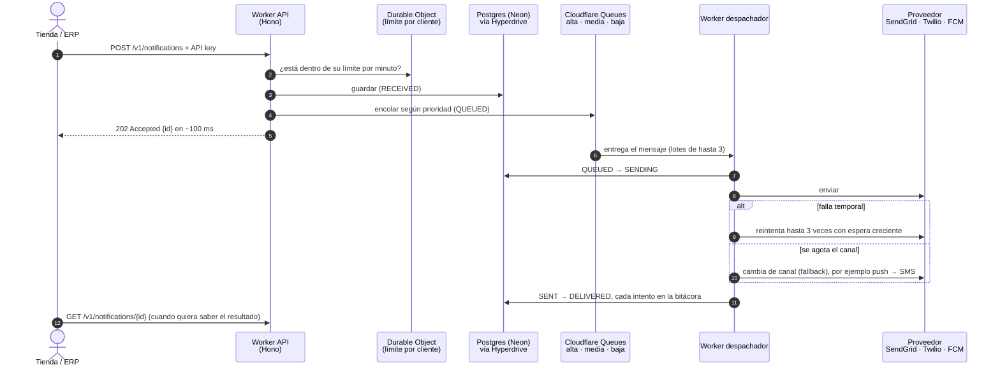

# Cola, Cloudflare y por qué no Docker ni Kubernetes

Guía para explicar cómo procesa NotifyHub una notificación, por qué usa una cola, por qué corre en Cloudflare y por
qué no se desplegó con Docker ni con Kubernetes. Las decisiones formales están en los ADR:
[002](adr/0002-colas-bullmq-redis.md) (colas por prioridad), [006](adr/0006-despliegue-cloudflare-containers.md)
(contenedores, descartada) y [007](adr/0007-workers-nativo.md) (Workers nativo, vigente).

## Resumen en cinco líneas

1. La tienda o el ERP manda la notificación a la API; la API la **guarda, la mete a una cola y responde al instante**.
2. Otro proceso, el **despachador**, saca la notificación de la cola y la envía, con reintentos y cambio de canal.
3. Todo corre en **Cloudflare, plan gratuito**: dos Workers, tres colas, un Durable Object y una conexión a Postgres.
4. **Docker** se usa solo en la máquina de desarrollo (Postgres y herramientas locales), no en producción.
5. **Kubernetes** no hace falta: Cloudflare ya escala, reinicia y reparte la carga sin que operemos servidores.

## 1. Cómo viaja una notificación (con cola)

Lo importante de este diseño:

- **La tienda no espera el envío.** Recibe `202 Accepted` con el `id` y consulta el resultado después, o lo ve en la
  consola. Un proveedor lento o caído nunca frena su proceso de venta.
- **Se guarda antes de encolar.** Si la cola falla, la notificación queda en `RECEIVED` y no se pierde.
- **Una cola por prioridad.** Un pico de avisos de prioridad baja (promociones) no retrasa los de prioridad alta
  (pago rechazado).
- **Absorbe picos.** Si llegan 1,000 pedidos de golpe, la cola los guarda y el despachador los saca a su ritmo,
  respetando el límite de cada proveedor (SendGrid 3, Twilio 2, FCM 5 envíos simultáneos).
- **Sin duplicados.** La cola entrega "al menos una vez"; el despachador revisa el estado antes de enviar y la
  `Idempotency-Key` evita que un reintento de la tienda genere un segundo aviso.

En la bitácora se ve así: `Recibida → En cola → Enviando → Enviada → Entregada`.

## 2. Con cola, asíncrono sin cola o síncrono

Son tres formas de resolver el mismo problema. Se evaluaron las tres y el proyecto se queda con la cola.

|                               | Con cola (la actual)         | Asíncrono sin cola                        | Síncrono                                        |
| ----------------------------- | ---------------------------- | ----------------------------------------- | ----------------------------------------------- |
| Qué hace la API               | Guarda, encola y responde    | Guarda, responde y envía en segundo plano | Guarda, envía y luego responde                  |
| Respuesta a la tienda         | Inmediata (`202`)            | Inmediata (`202`)                         | Cuando termina el envío (`200`)                 |
| La tienda conoce el resultado | Consultando después          | Consultando después                       | En la misma respuesta                           |
| Si el proveedor falla         | La tienda no se entera       | La tienda no se entera                    | La tienda espera los reintentos (3 a 5 s o más) |
| Picos de tráfico              | La cola los amortigua        | Cada petición envía en ese momento        | Cada petición espera su envío                   |
| Si se cae a medio envío       | La cola lo vuelve a entregar | Hace falta un barrido programado          | La tienda reintenta con la misma llave          |
| Piezas                        | API, colas y despachador     | API y un cron                             | Solo la API                                     |

**Por qué se queda la cola:** el requisito de rendimiento pide aceptar en menos de 200 ms (p95) y 1,000
notificaciones por minuto. Solo la versión con cola cumple las dos cosas sin que la tienda dependa de lo que tarde un
proveedor externo. El síncrono es más fácil de explicar, pero hace que la venta espere al correo o al SMS.

**Sobre la observación de "no mostrar la cola":** la cola es un detalle de implementación. Por eso los diagramas de
modelado (contexto, casos de uso, flujos, secuencia y estados) muestran el negocio sin la cola, y la cola aparece solo
en los diagramas de [contenedores](diagrams/render/02-contenedores.png) y
[despliegue](diagrams/render/07-despliegue.png), que describen cómo está construido.

## 3. Qué usamos de Cloudflare y para qué

| Pieza de Cloudflare               | En NotifyHub                                                 | Para qué sirve                                                                                          |
| --------------------------------- | ------------------------------------------------------------ | ------------------------------------------------------------------------------------------------------- |
| **Workers**                       | `notifyhub-api`, `notifyhub-dispatcher`, `notifyhub-console` | Ejecutan el código: la API, el despachador y la consola. Cada uno escala solo según las peticiones.     |
| **Queues**                        | `notifications-high`, `-medium`, `-low`                      | Las tres colas por prioridad entre la API y el despachador.                                             |
| **Durable Objects**               | `RateLimiterObject`                                          | Lleva la cuenta de solicitudes por minuto de cada cliente, en un solo lugar, sin Redis.                 |
| **Hyperdrive**                    | `notifyhub`                                                  | Mantiene abiertas las conexiones a Postgres (Neon) para que cada petición no tenga que abrir una nueva. |
| **Workers con activos estáticos** | `notifyhub-console`                                          | Sirve la consola web (Astro) sin un servidor aparte.                                                    |

La base de datos es **Postgres en Neon**, también en plan gratuito. Para el detalle de cómo se despliega cada pieza,
ver [despliegue](despliegue.md).

## 4. Por qué Cloudflare

1. **Costo 0 USD.** El plan gratuito incluye Workers, Queues, Durable Objects y Hyperdrive. Alcanza para la demo:
   100,000 peticiones al día a la API, 10,000 operaciones de cola al día (unas 3,300 notificaciones, porque cada una
   cuesta 3 operaciones: escribir, leer y borrar) y 100,000 consultas al día por Hyperdrive.
2. **Sin servidores que operar.** No hay máquinas, sistema operativo, parches ni reinicios. Se sube el código con
   `wrangler deploy` y Cloudflare lo ejecuta.
3. **Sin arranque en frío.** Un Worker responde en milisegundos desde la primera petición. La alternativa gratuita
   que se evaluó (Render) tardaba cerca de un minuto en despertar.
4. **Todo lo necesario en un solo proveedor.** La API, la cola, el límite por cliente y el pool de conexiones
   están en el mismo lugar; antes hacía falta además Redis para la cola y el límite.
5. **La arquitectura hexagonal lo permitió sin reescribir la lógica.** Al pasar de NestJS, BullMQ y Redis a Workers,
   Queues y Durable Objects solo cambiaron los adaptadores; el dominio, los casos de uso y sus pruebas quedaron igual
   ([ADR-007](adr/0007-workers-nativo.md)).

## 5. Por qué no Docker en producción

Docker sí se usa, pero **solo para desarrollar**. `infra/compose.yaml` levanta en la máquina de cada quien:

- Postgres 16, la base de datos local.
- Mailpit, un buzón de correo falso.
- WireMock, que simula a los proveedores.
- Grafana con Prometheus, Loki y Tempo, para ver métricas y trazas.

En producción no hay contenedores porque **Workers no ejecuta imágenes de Docker**: ejecuta el código directamente en
el entorno de Cloudflare. Sí se evaluó llevar la API en un contenedor
([ADR-006](adr/0006-despliegue-cloudflare-containers.md), Cloudflare Containers), pero exige el plan de pago (5 USD
al mes), los contenedores se duermen tras 15 minutos sin tráfico y la primera petición después tarda en arrancar. Se
descartó antes de desplegarse.

## 6. Por qué no Kubernetes

Kubernetes sirve para operar muchos contenedores en un grupo de servidores: decide cuántas copias correr, las
reinicia si fallan, reparte el tráfico y escala con la carga. Es la herramienta correcta cuando hay decenas de
servicios, mucho tráfico y un equipo que puede operarlo.

Para NotifyHub sería trabajo sin beneficio:

- **Cloudflare ya hace lo mismo.** Crea tantas copias de la API como peticiones lleguen, las apaga cuando no hay
  tráfico y reintenta lo que falla, sin configurar nada.
- **No hay contenedores que orquestar.** El sistema son dos Workers, tres colas y una base de datos administrada.
- **Costo y operación.** Un clúster de Kubernetes cuesta dinero aun sin tráfico y necesita a alguien que lo
  mantenga (versiones, nodos, red, certificados). El requisito de costo del proyecto es 0 USD.

## 7. ¿Un contenedor por API o varios?

Es una pregunta que se hace cuando se despliega con contenedores: cuántas copias de la API correr y de qué tamaño.
En NotifyHub **no hay que decidirlo**:

- Cada petición la atiende una instancia del Worker, y Cloudflare levanta todas las que haga falta, en paralelo y en
  el centro de datos más cercano a quien llama.
- Funciona porque la API **no guarda estado en memoria**: las notificaciones y la idempotencia viven en Postgres y
  el límite por cliente en un Durable Object. Da igual qué copia atienda cada petición.
- El despachador escala igual: Cloudflare le entrega lotes de hasta 3 mensajes por cola y crea más consumidores si
  la cola crece. El límite real lo pone cada proveedor (cuántos envíos simultáneos acepta), y eso se controla en
  Postgres para que se respete aunque haya varias copias del despachador.

## 8. Preguntas que pueden hacer en la presentación

**¿Por qué responden 202 y no 200?** Porque la API confirma que recibió y guardó la solicitud, no que ya se entregó.
El resultado se consulta con `GET /v1/notifications/{id}`.

**¿Qué pasa si se cae el despachador?** Los mensajes se quedan en la cola y se procesan cuando vuelve. Si un envío se
cortó a la mitad, el despachador lo detecta por su estado y lo retoma.

**¿Qué pasa si se cae la cola al encolar?** La notificación ya quedó guardada en `RECEIVED`, así que no se pierde.

**¿Se puede mandar dos veces el mismo aviso?** No, si la tienda usa la misma `Idempotency-Key` al reintentar: la API
devuelve la notificación original. La tienda de demostración usa `<pedido>:<evento>` como llave.

**¿Y si crece mucho?** El plan gratuito llega a unas 3,300 notificaciones al día. Con el plan de pago de Workers (5
USD al mes) los límites suben a millones sin cambiar el código.

**¿Por qué no Docker, si es lo más común?** Docker empaqueta una aplicación para correrla en un servidor. Aquí no
hay servidor que administrar: Cloudflare ejecuta el código directamente. Docker sigue siendo útil, y se usa, para
tener el mismo entorno local en todas las máquinas del equipo.
