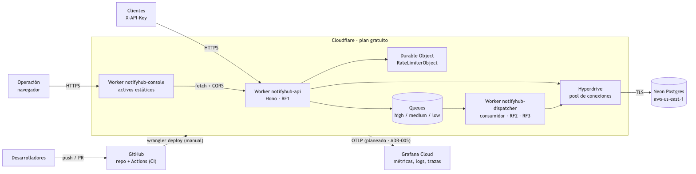

# Despliegue en Cloudflare (plan gratuito)

Decisión y razones en [ADR-007](adr/0007-workers-nativo.md).



## Qué está conectado

| Pieza           | Dónde                                                                      | Estado                |
| --------------- | -------------------------------------------------------------------------- | --------------------- |
| Código y CI     | GitHub `joseraulsoriano/notifyhub` (público)                               | ✅                    |
| Worker          | tu cuenta de Cloudflare (plan gratuito), Worker `notifyhub-api`            | ✅ desplegado         |
| Colas           | Queues `notifications-high`, `-medium`, `-low`                             | ✅ creadas            |
| Pool a Postgres | Hyperdrive `notifyhub` (su id va en `wrangler.jsonc`; usa el de tu cuenta) | ✅ creado             |
| Rate limit      | Durable Object `RateLimiterObject` (SQLite), se crea con el deploy         | ✅ desplegado         |
| Postgres        | Neon, proyecto `notifyhub`, `aws-us-east-1`, PG 18                         | ✅ migrado y sembrado |
| Despachador     | Worker `notifyhub-dispatcher`, consume las tres colas                      | ✅ desplegado         |
| Consola         | Worker `notifyhub-console` (activos estáticos)                             | ✅ desplegada         |
| Tablero         | Jira `arquitectura-so`, proyecto SCRUM                                     | ✅ al día             |

Límites del plan gratuito que importan: 100,000 peticiones/día al Worker, 10,000 operaciones/día de Queues (unas
3,300 notificaciones) y 100,000 consultas/día por Hyperdrive.

Última verificación (12 oct 2026): API, despachador y consola desplegados en ese orden; una notificación creada en producción pasó de QUEUED a DELIVERED por el despachador, y la consola responde con CORS correcto.

## Desplegar

Requisito: `wrangler login` hecho con la cuenta de arriba. No hace falta Docker ni secretos: la conexión a Neon vive
en la configuración de Hyperdrive.

```bash
pnpm install
pnpm turbo run build --filter=@notifyhub/api...
pnpm --filter @notifyhub/api run deploy      # imprime la URL https://notifyhub-api.<subdominio>.workers.dev
```

## Despachador

El Worker `notifyhub-dispatcher` (`apps/dispatcher`) consume las tres colas. Se despliega aparte y no tiene URL pública:

```bash
pnpm --filter @notifyhub/dispatcher run deploy
```

Una cola solo admite un consumidor: si ya hay otro Worker consumiendo `notifications-*`, el despliegue falla.

## Consola web

La consola (`apps/console`) es un sitio estático que se sirve como Worker con activos (plan gratuito), en `https://notifyhub-console.<subdominio>.workers.dev`. No lleva ninguna API key: quien la usa pega la URL y su llave en el diálogo «Conectar» y la llave solo vive en esa pestaña. Sin conexión funciona en modo demo con datos de ejemplo.

```bash
# la URL sugerida en el diálogo «Conectar» se fija al compilar
PUBLIC_NOTIFYHUB_API_URL=https://notifyhub-api.<subdominio>.workers.dev \
  pnpm --filter @notifyhub/console run deploy
```

Para que la consola pueda llamar a la API desde el navegador, su origen debe estar en `CORS_ALLOWED_ORIGINS` (variable en `apps/api/wrangler.jsonc`, ya incluye la consola y `localhost:4321`). Para que la salud de los proveedores se pueda editar desde la consola, agrega el nombre o id del cliente a `PROVIDER_ADMIN_CLIENTS` (en el panel de Cloudflare o con `--var`); vacío significa que nadie puede.

### Orden de despliegue de esta versión

Una cola solo admite un consumidor y el despachador procesa lo que haya en ellas, así que conviene este orden:

```bash
pnpm turbo run build
pnpm --filter @notifyhub/api run deploy          # nuevos endpoints: listado, proveedores y bitácora
pnpm --filter @notifyhub/dispatcher run deploy   # consume las colas y entrega con proveedores simulados
pnpm --filter @notifyhub/console run deploy
```

Para volver atrás: `npx wrangler rollback <versión>` desde `apps/api` (la versión anterior de la API es `486ceabe-4790-4535-9469-75c640044344`) y `npx wrangler delete --name notifyhub-dispatcher` para quitar el consumidor.

## Migraciones

Se aplican antes de desplegar, desde Node (Prisma no corre en el Worker):

```bash
DATABASE_URL="$(security find-generic-password -s notifyhub-database-url -a neon -w)" \
  pnpm --filter @notifyhub/persistence db:deploy
```

## Despliegue desde GitHub Actions

El workflow [Deploy](../.github/workflows/deploy.yml) se lanza a mano (`gh workflow run deploy.yml`) y necesita estos
secretos del repo, en el entorno `production`:

| Secreto                 | De dónde sale                                                          |
| ----------------------- | ---------------------------------------------------------------------- |
| `CLOUDFLARE_API_TOKEN`  | Token de cuenta con la plantilla "Edit Cloudflare Workers"             |
| `CLOUDFLARE_ACCOUNT_ID` | El id de tu cuenta (panel de Cloudflare → Workers)                     |
| `DATABASE_URL`          | Neon → proyecto `notifyhub` → Connection string (para las migraciones) |

## Verificación

```bash
URL=https://notifyhub-api.<subdominio>.workers.dev
KEY="$(security find-generic-password -s notifyhub-api-key -a prod -w)"
curl -s "$URL/health"
curl -s -X POST "$URL/v1/notifications" -H "X-API-Key: $KEY" -H "Idempotency-Key: $(uuidgen)" \
  -H 'Content-Type: application/json' \
  -d '{"sender":{"name":"Demo"},"recipient":{"email":"demo@example.com"},"message":{"body":"hola"},"priority":"alta","preferredChannel":"EMAIL"}'
```

La API key de producción se generó al sembrar Neon y vive solo en el llavero de macOS (`notifyhub-api-key`).

## Local

`pnpm infra:up` levanta Postgres; `pnpm dev` corre el Worker con `wrangler dev` en `http://localhost:8787`. Para ver las notificaciones avanzar hasta `DELIVERED` hay que correr la API y el despachador en la misma sesión (ver `apps/dispatcher/README.md`).
Hyperdrive usa `localConnectionString` de `apps/api/wrangler.jsonc`, y Queues y el Durable Object se simulan en
local. `tests/e2e/smoke.sh` hace lo mismo en CI.
