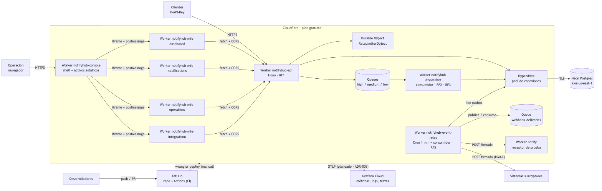

# Despliegue en Cloudflare (plan gratuito)

Decisión y razones en [ADR-007](adr/0007-workers-nativo.md).
Si es tu primer contacto con el repositorio, sigue antes la [guía del proyecto](guia-del-proyecto.md), que prepara
el entorno local y explica cómo validar el flujo antes de desplegar.



## Qué está conectado

| Pieza              | Dónde                                                                      | Estado                   |
| ------------------ | -------------------------------------------------------------------------- | ------------------------ |
| Código y CI        | GitHub `joseraulsoriano/notifyhub` (público)                               | ✅                       |
| Worker             | tu cuenta de Cloudflare (plan gratuito), Worker `notifyhub-api`            | ✅ desplegado            |
| Colas              | Queues `notifications-high`, `-medium`, `-low`                             | ✅ creadas               |
| Pool a Postgres    | Hyperdrive `notifyhub` (su id va en `wrangler.jsonc`; usa el de tu cuenta) | ✅ creado                |
| Rate limit         | Durable Object `RateLimiterObject` (SQLite), se crea con el deploy         | ✅ desplegado            |
| Postgres           | Neon, proyecto `notifyhub`, `aws-us-east-1`, PG 18                         | ✅ migrado y sembrado    |
| Despachador        | Worker `notifyhub-dispatcher`, consume las tres colas                      | ✅ desplegado            |
| Event relay        | Worker `notifyhub-event-relay`, Cron y queue de webhooks                   | desplegado (27-nov-2026) |
| Webhook inbox      | Worker público `notify`, verifica firmas y muestra eventos en Logs         | desplegado (27-nov-2026) |
| Shell consola      | Worker `notifyhub-console` (navegación y composición)                      | desplegado (27-nov-2026) |
| MFE dashboard      | Worker `notifyhub-mfe-dashboard`                                           | desplegado (27-nov-2026) |
| MFE notificaciones | Worker `notifyhub-mfe-notifications`                                       | desplegado (27-nov-2026) |
| MFE operaciones    | Worker `notifyhub-mfe-operations`                                          | desplegado (27-nov-2026) |
| MFE integraciones  | Worker `notifyhub-mfe-integrations`                                        | desplegado (27-nov-2026) |
| Tienda demo        | Worker `notifyhub-demo-store` o Vercel `notifyhub-demo-store`              | opcional                 |
| Tablero            | Jira `arquitectura-so`, proyecto SCRUM                                     | ✅ al día                |

Límites del plan gratuito que importan: 100,000 peticiones/día al Worker, 10,000 operaciones/día de Queues (unas
3,300 notificaciones) y 100,000 consultas/día por Hyperdrive.

Última verificación registrada (12 oct 2026): API, despachador y consola desplegados en ese orden; una notificación
creada en producción pasó de `QUEUED` a `DELIVERED` por el despachador y la consola respondió con CORS correcto.
El código de `event-relay` y `webhook-inbox` ya está en el repositorio y en el workflow, pero su despliegue posterior
debe verificarse en la cuenta de Cloudflare.

## Desplegar

Requisito: `wrangler login` hecho con la cuenta de arriba. No hace falta Docker ni secretos: la conexión a Neon vive
en la configuración de Hyperdrive.

```bash
pnpm install
pnpm turbo run build --filter=@notifyhub/api...
pnpm --filter @notifyhub/api run deploy      # imprime la URL https://notifyhub-api.<subdominio>.workers.dev
```

## Despachador

El Worker `notifyhub-dispatcher` (`apps/dispatcher`) consume las tres colas. Se despliega aparte y no tiene URL pública:

```bash
pnpm --filter @notifyhub/dispatcher run deploy
```

Una cola solo admite un consumidor: si ya hay otro Worker consumiendo `notifications-*`, el despliegue falla.

## Webhooks de eventos

El Worker `notifyhub-event-relay` publica el outbox cada minuto y consume la cola `webhook-deliveries`. El workflow
de despliegue crea esa cola si aún no existe y despliega la bandeja pública `notify` junto al relay después de la
API. La URL del receptor es `https://notify.<subdominio>.workers.dev/notify`; valida la firma con la suscripción
activa y registra solo metadatos del evento en Cloudflare Logs. La cola de mensajes fallidos se crea desde la
configuración del consumidor.

```bash
pnpm --filter @notifyhub/event-relay exec wrangler queues create webhook-deliveries # solo si aún no existe
pnpm --filter @notifyhub/webhook-inbox run deploy
pnpm --filter @notifyhub/event-relay run deploy
```

## Shell y microfrontends

La consola (`apps/console`) es un shell estático que se sirve como Worker con activos, en
`https://notifyhub-console.<subdominio>.workers.dev`. Sus rutas montan cuatro microfrontends independientes:

| Dominio        | Worker                        | Ruta local              |
| -------------- | ----------------------------- | ----------------------- |
| Dashboard      | `notifyhub-mfe-dashboard`     | `http://localhost:4331` |
| Notificaciones | `notifyhub-mfe-notifications` | `http://localhost:4332` |
| Operaciones    | `notifyhub-mfe-operations`    | `http://localhost:4333` |
| Integraciones  | `notifyhub-mfe-integrations`  | `http://localhost:4334` |

El shell entrega la conexión al iframe mediante `postMessage`; la API key nunca aparece en la URL. Cada MFE también
puede abrirse de forma independiente y tiene su propio diálogo de conexión. En producción, la API debe permitir los
cinco orígenes frontend en `CORS_ALLOWED_ORIGINS`.

```bash
# la URL sugerida en el diálogo «Conectar» se fija al compilar
PUBLIC_NOTIFYHUB_API_URL=https://notifyhub-api.<subdominio>.workers.dev \
  pnpm --filter @notifyhub/console run deploy

pnpm --filter @notifyhub/mfe-dashboard run deploy
pnpm --filter @notifyhub/mfe-notifications run deploy
pnpm --filter @notifyhub/mfe-operations run deploy
pnpm --filter @notifyhub/mfe-integrations run deploy
```

Para que la consola y sus microfrontends puedan llamar a la API desde el navegador, sus orígenes deben estar en
`CORS_ALLOWED_ORIGINS` (variable en `apps/api/wrangler.jsonc`, ya incluye los orígenes locales y los Workers públicos
del shell/MFEs). Para que la salud de los proveedores se pueda editar, agrega el nombre o id del cliente a
`PROVIDER_ADMIN_CLIENTS` (en el panel de Cloudflare o con `--var`); vacío significa que nadie puede.

### Orden de despliegue de esta versión

Aplica primero todas las migraciones pendientes (incluyen los leases globales de despacho y el aislamiento de
suscripciones por cliente). Una cola solo admite un consumidor y el despachador procesa lo que haya en ellas, así
que después conviene este orden:

```bash
pnpm --filter @notifyhub/persistence db:deploy
pnpm turbo run build
pnpm --filter @notifyhub/api run deploy          # nuevos endpoints: listado, proveedores y bitácora
pnpm --filter @notifyhub/dispatcher run deploy   # consume las colas y entrega con proveedores simulados
pnpm --filter @notifyhub/webhook-inbox run deploy # endpoint público de prueba: /notify
pnpm --filter @notifyhub/event-relay run deploy  # entrega eventos firmados a los suscriptores
pnpm --filter @notifyhub/mfe-dashboard run deploy
pnpm --filter @notifyhub/mfe-notifications run deploy
pnpm --filter @notifyhub/mfe-operations run deploy
pnpm --filter @notifyhub/mfe-integrations run deploy
pnpm --filter @notifyhub/console run deploy
```

Para volver atrás: `npx wrangler rollback <versión>` desde `apps/api` (la versión anterior de la API es `486ceabe-4790-4535-9469-75c640044344`) y `npx wrangler delete --name notifyhub-dispatcher` para quitar el consumidor.

## Migraciones

Se aplican antes de desplegar, desde Node (Prisma no corre en el Worker):

```bash
DATABASE_URL="$(security find-generic-password -s notifyhub-database-url -a neon -w)" \
  pnpm --filter @notifyhub/persistence db:deploy
```

## Despliegue desde GitHub Actions

El workflow [Deploy](../.github/workflows/deploy.yml) se lanza a mano (`gh workflow run deploy.yml`) y necesita estos
secretos del repo, en el entorno `production`:

| Secreto                 | De dónde sale                                                          |
| ----------------------- | ---------------------------------------------------------------------- |
| `CLOUDFLARE_API_TOKEN`  | Token de cuenta con la plantilla "Edit Cloudflare Workers"             |
| `CLOUDFLARE_ACCOUNT_ID` | El id de tu cuenta (panel de Cloudflare → Workers)                     |
| `DATABASE_URL`          | Neon → proyecto `notifyhub` → Connection string (para las migraciones) |

## Verificación

```bash
URL=https://notifyhub-api.<subdominio>.workers.dev
KEY="$(security find-generic-password -s notifyhub-api-key -a prod -w)"
curl -s "$URL/health"
curl -s -X POST "$URL/v1/notifications" -H "X-API-Key: $KEY" -H "Idempotency-Key: $(uuidgen)" \
  -H 'Content-Type: application/json' \
  -d '{"sender":{"name":"Demo"},"recipient":{"email":"demo@example.com"},"message":{"body":"hola"},"priority":"alta","preferredChannel":"EMAIL"}'
```

La API key de producción se generó al sembrar Neon y vive solo en el llavero de macOS (`notifyhub-api-key`).

## Antes de desplegar

Confirma primero el recorrido local de la [guía del proyecto](guia-del-proyecto.md). `pnpm dev` inicia solamente la
API; para procesar notificaciones hay que ejecutar API y despachador juntos con la configuración de Wrangler de
ambos. En local, Hyperdrive usa PostgreSQL de Docker Compose y Queues/Durable Objects son simulados. No uses
`wrangler dev --remote` para una prueba que deba permanecer aislada: ese modo puede acceder a recursos reales.

El despliegue actualiza recursos de la cuenta configurada en Wrangler. Antes de continuar, verifica el account, los
IDs de Hyperdrive/Queues y el Worker destino; aplica migraciones a la base prevista y despliega API, consumidores,
microfrontends y shell en el orden indicado arriba. `tests/e2e/smoke.sh` ejecuta la verificación aislada que usa CI.
