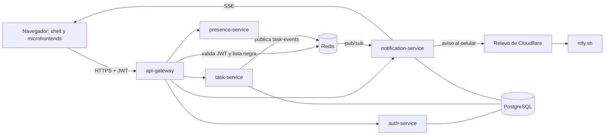

# NotifyHub y TaskFlow: documentación de la entrega

Proyecto de notificaciones en dos versiones con arquitecturas distintas. La versión 1 (NotifyHub) es modular y serverless. La versión 2 (TaskFlow) implementa el Proyecto 4 del documento de proyectos: microservicios con API Gateway, JWT con roles y Redis.

## Enlaces

| Qué                                             | Enlace                                                        |
| ----------------------------------------------- | ------------------------------------------------------------- |
| Repositorio                                     | https://github.com/joseraulsoriano/notifyhub                  |
| **TaskFlow (v2)**: aplicación                   | https://taskflow-console.sc202357155.workers.dev              |
| TaskFlow: arquitectura en vivo                  | https://taskflow-console.sc202357155.workers.dev/arquitectura |
| TaskFlow: documentación de la API (Swagger UI)  | https://taskflow-gateway-y6dh.onrender.com/docs               |
| **NotifyHub (v1)**: aplicación                  | https://notifyhub-console.sc202357155.workers.dev             |
| NotifyHub: documentación de la API (Swagger UI) | https://notifyhub-api.sc202357155.workers.dev/docs            |

La especificación OpenAPI de cada API se descarga en `/openapi.yaml` de su mismo servidor.

## 1. Arquitectura: qué cambia entre la versión 1 y la 2

|                | NotifyHub (v1)                                                      | TaskFlow (v2)                                              |
| -------------- | ------------------------------------------------------------------- | ---------------------------------------------------------- |
| Estilo         | Modular serverless                                                  | Microservicios con API Gateway                             |
| Entrada        | API key por cliente                                                 | JWT con roles (admin, líder, miembro)                      |
| Estado         | Cloudflare Queues y PostgreSQL (Neon)                               | Redis (caché, sesiones, lista negra, pub/sub) y PostgreSQL |
| Despliegue     | Workers de Cloudflare                                               | Contenedores Docker en Render                              |
| Frontend       | Shell y 4 microfrontends                                            | Shell y 2 microfrontends                                   |
| Notificaciones | Es el producto: correo, SMS, push y webhook (proveedores simulados) | Evento en Redis, servicio propio, campana web y celular    |

Las dos versiones son sistemas independientes. Comparten código de interfaz (la campana de notificaciones y el puente entre el shell y los microfrontends), pero no datos: TaskFlow no envía sus avisos a través de NotifyHub.

## 2. Cumplimiento del Proyecto 4 (gestión de tareas colaborativo con notificaciones)

| Requerimiento                                   | Estado | Cómo se cumple y cómo se comprobó                                                         |
| ----------------------------------------------- | ------ | ----------------------------------------------------------------------------------------- |
| RF1 Registro e inicio de sesión con JWT y rol   | Cumple | `auth-service`; el JWT incluye el rol. Probado en producción.                             |
| RF2 Crear proyectos y tareas                    | Cumple | `task-service`; flujo recorrido en el navegador.                                          |
| RF3 Solo líder o admin asigna tareas            | Cumple | Un miembro recibe 403 al asignar (comprobado en producción).                              |
| RF4 El asignado cambia el estado                | Cumple | Quien no es responsable recibe 403 (comprobado).                                          |
| RF5 Caché de tareas con invalidación            | Cumple | La respuesta indica `source: cache` o `database`; se invalida al actualizar. TTL de 60 s. |
| RF6 Publicar evento en canal Redis              | Cumple | Canal `task-events` (asignación y cambio de estado).                                      |
| RF7 Servicio de notificaciones suscrito a Redis | Cumple | `notification-service` guarda en PostgreSQL y emite por SSE y al celular.                 |
| RF8 Usuario en línea y sesiones con expiración  | Cumple | `presence-service`; TTL igual al del token (900 s).                                       |
| RF9 Listar tareas con cache-aside               | Cumple | Primera lectura de PostgreSQL, siguientes de Redis (comprobado).                          |
| RF10 Logout con lista negra en Redis            | Cumple | Tras cerrar sesión el token da 401 `token_revoked` (comprobado).                          |

### Recomendaciones generales del documento de proyectos

| Recomendación                                               | Estado                                                                                                                                                              |
| ----------------------------------------------------------- | ------------------------------------------------------------------------------------------------------------------------------------------------------------------- |
| API Gateway que centraliza la validación de JWT             | Cumple. Además firma cada llamada interna con un token compartido; un servicio interno rechaza identidades falsificadas (401).                                      |
| Patrón cache-aside con Redis                                | Cumple (tareas).                                                                                                                                                    |
| TTL adecuados                                               | Cumple: token y sesión 900 s, caché de tareas 60 s, presencia igual al token.                                                                                       |
| Documentar cada API con OpenAPI/Swagger                     | Cumple: Swagger UI en `/docs` de TaskFlow (25 operaciones) y de NotifyHub.                                                                                          |
| Pruebas unitarias y de integración por microservicio        | **Parcial.** Hay pruebas unitarias compartidas y una prueba de integración de extremo a extremo del conjunto, pero no una carpeta de pruebas separada por servicio. |
| Dockerizar cada servicio y levantar todo con docker-compose | Cumple: un `Dockerfile` por servicio y `compose.yaml` con servicios, Redis y PostgreSQL.                                                                            |

## 3. Notificaciones centralizadas en microfrontends

Cada microfrontend vive en un `iframe` de otro origen, así que no puede mostrar avisos por sí mismo ni compartir eventos del navegador. El diseño es:

- El microfrontend llama a `notify()` y envía el aviso al shell por `postMessage`, con un contrato estricto (`id`, `severity`, `title`, `message`, `sourceMfe`, `actionUrl`, `ttl`).
- El shell valida el aviso y fija él mismo el origen (`sourceMfe`) según el iframe, de modo que un módulo no puede hacerse pasar por otro. Las rutas de acción solo pueden ser internas.
- La bandeja del shell (campana con contador, historial, expiración por `ttl` y sincronía entre pestañas) decide cómo se muestran y se descartan los avisos.
- Cada módulo decide solo cuándo ocurre un evento de su dominio.

En TaskFlow el shell, además, abre el flujo SSE del servicio de notificaciones y convierte cada evento de Redis en un aviso de la campana.

## 4. Notificaciones al celular

1. En «Equipo y sesión» se activa un tema de [ntfy](https://ntfy.sh) y se suscribe la app (gratuita, sin cuenta).
2. Al asignar una tarea o cambiar su estado, el servicio publica el aviso.
3. Render no logra conectarse a `ntfy.sh`, así que el servicio publica por un relevo mínimo en Cloudflare (`taskflow-push-relay`) que reenvía a `ntfy.sh`.
4. Minimización de datos: solo viajan el título de la tarea y su estado, nunca correos ni nombres. El relevo solo acepta temas `taskflow-…`, mensajes cortos y no reenvía enlaces.

Los avisos no llegan a quien realiza la acción: si te asignas una tarea a ti mismo no recibes notificación. Para verlo se necesitan dos usuarios.

## 5. Seguridad

- JWT con emisor, expiración de 900 s y lista negra en Redis al cerrar sesión.
- Los microservicios internos exigen un secreto compartido del gateway; sin él responden 401.
- CORS solo para los orígenes del frontend.
- El directorio de usuarios no expone correos.
- PostgreSQL y Redis de Render están configurados para aceptar solo la red privada (lista de IP permitidas vacía).
- La documentación de la API es pública; el resto exige JWT o API key.

## 6. Cómo probarlo (5 minutos)

1. Abrir TaskFlow, pulsar «Crear cuenta» y registrar un usuario.
2. En «Equipo y sesión», activar el tema de ntfy y suscribir la app en el celular (opcional).
3. En una ventana de incógnito, registrar un segundo usuario, crear un proyecto que incluya al primero como miembro y crear una tarea asignada a él.
4. El primer usuario ve el aviso en la campana al instante y, si activó ntfy, en el celular.
5. El primer usuario cambia el estado de la tarea; el líder recibe el aviso del cambio.
6. Abrir «Arquitectura» para ver la salud en vivo de cada servicio, y `/docs` para la documentación de la API.

## 7. Calidad verificada

- Monorepo: todas las suites en verde (API 57, aplicación 35, interfaz 39, runtime de microfrontends 35, cliente 13, proveedores 12, tienda de demostración 12, dominio 4, relay de eventos 5, buzón de webhooks 2, compartido 2, kit de TaskFlow 3 y relevo de push 4), más lint y compilación completos.
- TaskFlow (`version-2`): 15 pruebas unitarias en verde y una prueba de integración de extremo a extremo contra el conjunto levantado con Docker.
- Pruebas manuales en producción: 13 comprobaciones de seguridad y reglas de negocio, el flujo completo de tareas con notificaciones en tiempo real y el envío real al celular.

## 8. Limitaciones conocidas

- **Arranque en frío:** en el plan gratuito de Render los servicios se duermen tras 15 minutos sin tráfico y tardan unos 20 segundos en despertar. Durante ese tiempo la página de arquitectura puede mostrar servicios en rojo.
- **Proveedores simulados:** en NotifyHub los proveedores de correo, SMS y push son simulados; no envían mensajes reales.
- **Sin plataforma de QA automática:** la verificación se hizo con pruebas del repositorio y con el navegador contra los enlaces reales.
- **Despliegue temporal:** el entorno se baja tras la entrega.

## 9. Cómo bajar el entorno

- Render: borrar el Blueprint `notify` desde el panel (servicios, base de datos y Redis).
- Cloudflare: `wrangler delete --name taskflow-console` y lo mismo para `taskflow-mfe-projects`, `taskflow-mfe-team` y `taskflow-push-relay`.
