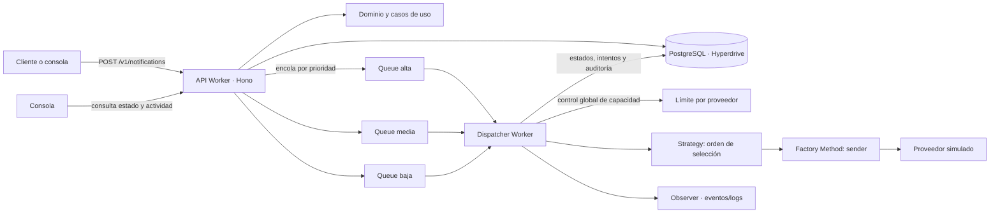

# Guía del proyecto: de local a producción

Esta guía está pensada para quien abre NotifyHub por primera vez. Primero levanta una versión local y prueba el
recorrido completo; después explica la arquitectura y cómo se controla el despacho. Al final describe qué cambia al
llevarlo a Cloudflare.

> **Importante:** los proveedores de correo, SMS, push y webhook de este proyecto son simulados. La demo registra
> intentos y respuestas ficticias; no envía mensajes reales a clientes.

## 1. Qué necesitas

- Git
- Node.js 22 o superior
- pnpm 11
- Docker Desktop instalado

Comprueba las herramientas desde una terminal:

```bash
node --version
pnpm --version
```

`pnpm demo:local` intenta abrir Docker Desktop automáticamente en macOS y espera hasta 90 segundos a que el daemon
esté listo. En otros sistemas, o si macOS no logra abrirlo, inicia Docker Desktop manualmente y vuelve a ejecutar
el comando.

## 2. Preparar la base local

Desde la raíz del repositorio:

```bash
pnpm install
pnpm demo:local
```

`pnpm install` se hace una vez después de clonar o cambiar dependencias. Después, **un solo comando** arranca la
base, aplica las migraciones, crea el cliente y los proveedores de prueba y levanta API + despachador + consola.
Necesitas Docker Desktop instalado y el puerto `5432` libre. Si no existe `.env`, el comando lo crea desde
`.env.example`. Para que la demo no toque una base remota por error, migrations y seed siempre fuerzan el Postgres
local del Compose (`127.0.0.1:5432`) y el API key `nh_dev_local_key`, aunque tu `.env` tenga otra `DATABASE_URL`.

Las migraciones crean las tablas; el seed agrega el cliente local (`nh_dev_local_key`) y el catálogo de proveedores.
El seed **no** crea notificaciones de ejemplo: al abrir la consola, la lista está vacía hasta que envíes una solicitud.

El comando anuncia la URL de Astro y deja disponible la API en `http://localhost:8787`. Conecta la consola con la
API key `nh_dev_local_key`; en esta ejecución local, también autoriza cambiar la salud simulada de proveedores.
Presiona `Ctrl+C` para detener la consola y los Workers. PostgreSQL queda activo para que la base local persista
entre demostraciones. Para detenerla también:

```bash
pnpm infra:down
```

## 3. Arrancar y probar el flujo local

Al abrir Astro, pulsa **Conectar** e ingresa:

- URL de API: `http://localhost:8787`
- API key: `nh_dev_local_key`

La conexión se guarda en `sessionStorage` por pestaña. Si abres otra ventana, conéctala también a esta URL y llave:
al usar la API local, ambas ventanas consultan las mismas notificaciones de PostgreSQL. En **Modo demo** cada
pestaña conserva datos de ejemplo independientes y no comparte solicitudes con la API.

La API y el despachador se ejecutan juntos en la misma sesión de Wrangler para compartir las Queues locales. Envía
una notificación desde **Nueva solicitud** con un canal y prioridad. Debe aparecer primero como `QUEUED` y
después recorrer el despacho y la bitácora hasta `DELIVERED` o el resultado correspondiente. Revisa **Notificaciones**,
**Bitácora** y **Proveedores y ruteo** para ver la misma operación desde distintas perspectivas.

También puedes probar el contrato HTTP directamente:

```bash
curl -X POST http://localhost:8787/v1/notifications \
  -H 'X-API-Key: nh_dev_local_key' \
  -H 'Idempotency-Key: demo-local-0001' \
  -H 'Content-Type: application/json' \
  -d '{
    "sender": { "name": "Demo local" },
    "recipient": { "email": "ana@example.com", "phone": "+5212221234567" },
    "message": { "subject": "Prueba", "body": "Notificación de demostración" },
    "priority": "alta",
    "preferredChannel": "EMAIL"
  }'
```

La respuesta `202 Accepted` significa que la solicitud fue aceptada y encolada; no significa que el proveedor ya la
haya entregado. Usa el `id` de la respuesta en `GET /v1/notifications/{id}` para consultar su avance.

### Observar fallback

Con el Worker local ejecutándose y el permiso administrativo habilitado, cambia `fcm` a **Caído** en
**Proveedores y ruteo** y envía una solicitud Push que también tenga teléfono. El despachador simula los reintentos
fallidos de FCM y después intenta SMS según la cadena de fallback. Restaura el estado del proveedor al terminar.

### Observar concurrencia

La API recibe cada solicitud HTTP independientemente y las encola por prioridad. El consumidor procesa mensajes
independientes con concurrencia acotada; el límite global por proveedor evita superar la capacidad configurada aunque
lleguen trabajos desde colas de prioridades distintas. La consola muestra el límite y la actividad vigente por
proveedor. Para que la demostración sea visible, envía varias solicitudes del mismo canal en un intervalo corto y
observa cuáles están en ejecución y cuáles esperan una plaza. Reintentos y fallback pertenecen a la misma solicitud:
no crean una nueva solicitud externa.

> La versión local es una simulación: Queues y Durable Objects corren localmente y Hyperdrive conecta al PostgreSQL
> de Docker. En producción, el mismo código usa los recursos Cloudflare configurados y la base de Neon.

## 4. Cómo está organizado y qué arquitectura usa

NotifyHub combina varias perspectivas; no son alternativas excluyentes:

- **Arquitectura hexagonal / por capas:** organiza el código. `domain` contiene reglas y estados; `application`
  contiene casos de uso y puertos; `apps` y `packages` de infraestructura implementan HTTP, persistencia, colas y
  proveedores.
- **Arquitectura dirigida por eventos:** describe el flujo de una solicitud aceptada. La API la persiste y publica
  un trabajo en una Queue; el despachador procesa el trabajo y registra cambios de estado e intentos. El patrón
  Observer publica eventos de despacho. Esto no significa que cada capa sea un microservicio.
- **Servicios distribuidos/serverless:** la API y el despachador son Workers separados, y la consola es un frontend
  estático. Son unidades desplegables separadas; para este proyecto, esta descripción es más precisa que afirmar que
  todo el sistema es un conjunto amplio de microservicios.
- **Microfrontends:** no aplica; existe una única consola web.



El recorrido está desacoplado: la API no espera a que el proveedor termine. La prioridad selecciona una de tres
colas, mientras el canal preferente y la estrategia seleccionan proveedor/canal durante el despacho.

### Por qué esta arquitectura

Las opciones describen niveles distintos, por eso NotifyHub combina varias en lugar de escoger solo una:

- **Hexagonal, expresada también por capas, para organizar el código.** El dominio no depende de Hono, PostgreSQL
  ni Cloudflare. Los casos de uso hablan con puertos (`NotificationRepository`, `NotificationQueue`,
  `DispatchCapacityRepository`) y los paquetes de persistencia/infraestructura los implementan. Así se prueban las
  reglas con adaptadores en memoria y se puede sustituir una integración sin reescribir el dominio. «Por capas» no
  es incorrecto; hexagonal precisa la dirección de las dependencias y el papel de los puertos/adaptadores.
- **Dirigida por eventos para el trabajo asíncrono.** La API acepta y encola; el Worker consumidor trabaja después
  desde Cloudflare Queues. Esto evita que una petición HTTP tenga que esperar reintentos y respuesta del proveedor,
  absorbe picos y permite límites/reintentos independientes. Queue entrega al menos una vez, por eso el despacho
  usa claims de propiedad e idempotencia para evitar procesar simultáneamente la misma notificación.
- **Workers separados como unidades de despliegue.** API y consumidor escalan/despliegan por separado, pero comparten
  PostgreSQL y el estado del servicio. «Serverless/distribuida» es una descripción más precisa hoy que afirmar que
  NotifyHub ya tiene microservicios autónomos con datos y ciclos de vida independientes.
- **No es una arquitectura de microfrontends.** La consola es una aplicación web única, no varias aplicaciones UI
  desplegadas por separado.

También se combinan patrones GoF con propósitos concretos: **Strategy** elige el orden de proveedores según
prioridad; **Factory Method** crea el sender del proveedor; **Observer** desacopla al despachador de los
consumidores internos de eventos. Los logs Observer están activos, pero el relay durable de outbox a webhooks
suscritos aún no está implementado.

### Cómo se usa la API

Todas las rutas `/v1/*` requieren `X-API-Key`, tienen límite por cliente y devuelven errores
`application/problem+json`. La API key identifica al cliente y filtra sus notificaciones y suscripciones. La ruta
`/health` solo indica que el Worker responde: **no** comprueba base de datos, migraciones, Queue ni proveedores.

| Ruta                                      | Para qué sirve                                                    | Resultado importante                                                       |
| ----------------------------------------- | ----------------------------------------------------------------- | -------------------------------------------------------------------------- |
| `POST /v1/notifications`                  | Valida una solicitud, la persiste y la encola según prioridad.    | `202 Accepted` confirma aceptación, no entrega; incluye `id` y `Location`. |
| `GET /v1/notifications?limit=50&cursor=…` | Lista las notificaciones del cliente, con contactos enmascarados. | Página y cursor siguiente.                                                 |
| `GET /v1/notifications/{id}`              | Consulta estado, intentos y transiciones del recurso del cliente. | `404` si no existe o pertenece a otro cliente.                             |
| `GET /v1/providers`                       | Lee el catálogo y su salud desde PostgreSQL.                      | Requiere DB accesible, migraciones y seed.                                 |
| `PATCH /v1/providers/{code}`              | Cambia salud/habilitación global de un proveedor.                 | Solo clientes incluidos en `PROVIDER_ADMIN_CLIENTS`; si no, `403`.         |
| `GET /v1/dispatch/capacity`               | Lee límites globales, activos y en espera por proveedor.          | Los límites son de solo lectura y los conteos no incluyen IDs.             |
| `GET /v1/audit-log`                       | Consulta intentos y cambios de estado del cliente.                | Paginado y con filtros; datos personales enmascarados.                     |
| `GET/POST /v1/subscriptions`              | Consulta o registra destinos HTTPS y tipos de evento del cliente. | `POST` devuelve un secreto de firma una sola vez.                          |
| `PATCH /v1/subscriptions/{id}`            | Activa o pausa una configuración de suscripción propia.           | `404` también si el ID pertenece a otro cliente.                           |

Ejemplo para seguir una solicitud:

```bash
curl -i -X POST http://localhost:8787/v1/notifications \
  -H 'X-API-Key: nh_dev_local_key' \
  -H 'Idempotency-Key: demo-local-0002' \
  -H 'Content-Type: application/json' \
  -d '{"sender":{"name":"Demo"},"recipient":{"email":"ana@example.com","phone":"+5212221234567"},"message":{"body":"Prueba"},"priority":"alta","preferredChannel":"EMAIL"}'
curl http://localhost:8787/v1/notifications/ID_DE_LA_RESPUESTA \
  -H 'X-API-Key: nh_dev_local_key'
```

Errores comunes: `400` indica JSON/campos inválidos; `401`, API key ausente o inválida; `403`, cliente sin
permiso administrativo para cambiar proveedor; `404`, recurso inexistente/no propio; `429`, límite excedido (revisa
`Retry-After`); `500`, fallo interno. En `500`, consulta los logs de `wrangler dev`: si ves `connection attempt
failed`, arranca Docker/PostgreSQL; si la tabla no existe, aplica `db:deploy` y `db:seed`. La consola no puede
validar la API key si no puede alcanzar la base donde se guarda su hash.

### Qué significa la salud de un proveedor

**En este proyecto el envío es simulado.** La salud no es un health-check automático de SendGrid, Twilio o Firebase:
es un estado de demostración editable. `UP` simula HTTP 200; `DEGRADED` simula fallos intermitentes y más latencia;
`DOWN` simula HTTP 503. Por eso se puede ver el flujo de reintentos/fallback sin credenciales ni envíos reales.

El código común de los adaptadores convierte una respuesta 2xx en éxito; considera 429 y 5xx transitorios, y otros
códigos como permanentes. Un timeout de 30 s o error de red también es transitorio. Lo registra como intento
`RETRYING`/`FAILED`, espera con backoff exponencial (500 ms base, máximo 10 s) y reintenta hasta tres veces por
proveedor. Si se agotan, `DispatchService` pasa al siguiente canal configurado solo si existe el dato de contacto
requerido; en Push, por ejemplo, puede seguir con SMS y luego Email. Cuando se integre un proveedor real, su
adaptador HTTP deberá mapear sus códigos/respuestas reales a estas categorías y sus logs/métricas deberán alimentar
una política de salud; eso todavía no está conectado aquí.

Para que **Proveedores y ruteo** funcione en local:

1. El comando `pnpm demo:local` ya arranca PostgreSQL, migra y siembra la base. `GET /v1/providers` y
   `/v1/dispatch/capacity` consultan esa base.
2. La demo habilita el control de salud únicamente en el Worker local. No copies ese permiso abierto a producción.
3. En **Nueva solicitud**, manda Push con `deviceToken` y también teléfono/email de respaldo. Marca FCM como caído,
   vuelve a enviar y mira **Notificaciones** y **Bitácora**. La prueba falla artificialmente tres veces en FCM y
   luego intenta SMS. Las reglas visibles no son edición dinámica: el Worker usa los valores compilados en
   `packages/application/src/dispatch/routing-config.ts`; `config/routing.yaml` y la consola son espejos que deben
   mantenerse sincronizados. Cambiar solo el YAML no cambia el comportamiento del Worker.

### Dónde ver los patrones y requisitos

| Concepto                                             | Código                                                                                 |
| ---------------------------------------------------- | -------------------------------------------------------------------------------------- |
| Factory Method y registro de emisores                | `packages/application/src/dispatch/sender-creator.ts`, `packages/providers/src/`       |
| Strategy por prioridad                               | `packages/application/src/dispatch/strategies.ts`, `config/routing.yaml`               |
| Observer y publicación de eventos                    | `packages/application/src/dispatch/event-publisher.ts`, `apps/dispatcher/src/index.ts` |
| Registro de suscripciones (sin relay de entrega aún) | `apps/api/src/app.ts`, `packages/persistence/src/pg-subscription-repository.ts`        |
| Reintentos y fallback                                | `packages/application/src/dispatch/dispatch-service.ts`                                |
| Recepción, validación y encolado (RF1)               | `apps/api/src/app.ts`                                                                  |
| Adaptadores de datos y Queue                         | `apps/api/src/infra/`, `packages/persistence/src/`                                     |
| Consola                                              | `apps/console/src/`                                                                    |

## 5. Qué cambia al ejecutar en producción

En local, Wrangler simula la ejecución de Workers, Queues y Durable Objects, y la configuración `localConnectionString`
de Hyperdrive apunta a Docker. En producción:

| Local                                            | Producción                                                   |
| ------------------------------------------------ | ------------------------------------------------------------ |
| API y dispatcher ejecutados por `wrangler dev`   | Workers `notifyhub-api` y `notifyhub-dispatcher` desplegados |
| Queues simuladas por Wrangler                    | Queues Cloudflare `notifications-high/medium/low`            |
| Postgres de Docker Compose                       | Postgres de Neon detrás de Hyperdrive                        |
| Llave `nh_dev_local_key` y proveedores simulados | Llaves de producción y configuración protegida               |
| Consola Astro en localhost                       | Consola estática desplegada como Worker                      |

Para producción se necesita una cuenta Cloudflare con los recursos configurados en `apps/api/wrangler.jsonc` y
`apps/dispatcher/wrangler.jsonc`, una conexión de base de datos de Neon y los secretos de despliegue. No reutilices el
`.env` local ni `nh_dev_local_key`. `DATABASE_URL` se usa desde un entorno seguro para ejecutar migraciones; el Worker
accede a la base mediante el binding Hyperdrive.

El orden conceptual del despliegue es: **migrar Neon → desplegar API → desplegar consumidor → compilar/desplegar
consola → verificar**. Los comandos, permisos y comprobaciones están en [Despliegue](despliegue.md). No ejecutes un
despliegue remoto como parte de una prueba local.

## 6. Comandos de desarrollo

Desde la raíz:

```bash
pnpm build       # compila todos los paquetes
pnpm test        # pruebas automatizadas
pnpm typecheck   # contratos y tipos
pnpm lint        # ESLint
```

El detalle operativo y las decisiones técnicas se documentan en [ADR](adr/README.md), [despliegue](despliegue.md) y
[avance del proyecto](avance.md).
