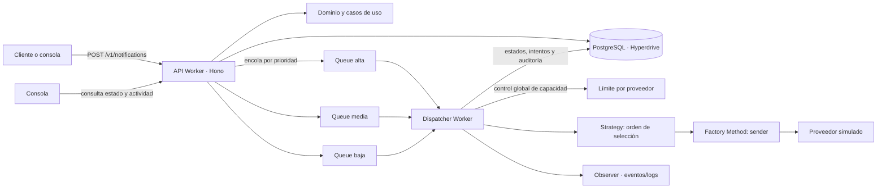

# Guía del proyecto: de local a producción

Esta guía está pensada para quien abre NotifyHub por primera vez. Primero levanta una versión local y prueba el
recorrido completo; después explica la arquitectura y cómo se controla el despacho. Al final describe qué cambia al
llevarlo a Cloudflare.

> **Importante:** los proveedores de correo, SMS, push y webhook de este proyecto son simulados. La demo registra
> intentos y respuestas ficticias; no envía mensajes reales a clientes.

## 1. Qué necesitas

- Git
- Node.js 22 o superior
- pnpm 11
- Docker Desktop instalado y **en ejecución**

Comprueba las herramientas desde una terminal:

```bash
node --version
pnpm --version
docker info
```

`docker info` debe poder comunicarse con el daemon. Si falla con «Cannot connect to the Docker daemon», abre Docker
Desktop y espera a que indique que está listo antes de continuar.

## 2. Preparar la base local

Desde la raíz del repositorio:

```bash
pnpm install
cp .env.example .env
pnpm infra:up
pnpm build
pnpm --filter @notifyhub/persistence db:deploy
pnpm db:seed
```

El `.env.example` configura PostgreSQL local en `localhost:5432` y una llave de desarrollo. No pongas credenciales de
producción en este archivo. Si ya existe tu `.env`, consérvalo y comprueba que `DATABASE_URL` apunte al Postgres local.
Espera a que Docker termine de iniciar los contenedores antes de compilar, aplicar migraciones y sembrar el catálogo.

Las migraciones crean las tablas; el seed agrega el cliente local (`nh_dev_local_key`) y el catálogo de proveedores.
El seed **no** crea notificaciones de ejemplo: al abrir la consola, la lista está vacía hasta que envíes una solicitud.

Para comprobar los servicios:

```bash
docker compose -f infra/compose.yaml ps
```

Si cambias el esquema, vuelve a aplicar la migración correspondiente. Para apagar el entorno al terminar:

```bash
pnpm infra:down
```

## 3. Arrancar y probar el flujo local

Abre dos terminales en la raíz del repositorio.

**Terminal 1 — API y despachador** (misma sesión local para que compartan las Queues simuladas):

```bash
cd apps/api
pnpm exec wrangler dev -c wrangler.jsonc -c ../dispatcher/wrangler.jsonc --port 8787
```

El proceso debe anunciar que escucha en `http://localhost:8787`. La consola Wrangler muestra las colas locales y el
Worker despachador que las consume. Para probar cambios de salud de proveedores desde la consola, agrega
`--var "PROVIDER_ADMIN_CLIENTS:*"` al comando; es un permiso de desarrollo, no lo copies a producción sin decidir
quién debe administrar proveedores.

**Terminal 2 — consola web:**

```bash
pnpm --filter @notifyhub/console dev
```

Abre la URL que Astro imprima (normalmente `http://localhost:4321`; si ese puerto está ocupado puede usar `4322`).
El modo demo funciona sin servidor y empieza vacío. Para probar el backend, abre **Conectar** e ingresa:

- URL de API: `http://localhost:8787`
- API key: `nh_dev_local_key`

Envía una notificación desde **Nueva solicitud** con un canal y prioridad. Debe aparecer primero como `QUEUED` y
después recorrer el despacho y la bitácora hasta `DELIVERED` o el resultado correspondiente. Revisa **Notificaciones**,
**Bitácora** y **Proveedores y ruteo** para ver la misma operación desde distintas perspectivas.

También puedes probar el contrato HTTP directamente:

```bash
curl -X POST http://localhost:8787/v1/notifications \
  -H 'X-API-Key: nh_dev_local_key' \
  -H 'Idempotency-Key: demo-local-0001' \
  -H 'Content-Type: application/json' \
  -d '{
    "sender": { "name": "Demo local" },
    "recipient": { "email": "ana@example.com", "phone": "+5212221234567" },
    "message": { "subject": "Prueba", "body": "Notificación de demostración" },
    "priority": "alta",
    "preferredChannel": "EMAIL"
  }'
```

La respuesta `202 Accepted` significa que la solicitud fue aceptada y encolada; no significa que el proveedor ya la
haya entregado. Usa el `id` de la respuesta en `GET /v1/notifications/{id}` para consultar su avance.

### Observar fallback

Con el Worker local ejecutándose y el permiso administrativo habilitado, cambia `fcm` a **Caído** en
**Proveedores y ruteo** y envía una solicitud Push que también tenga teléfono. El despachador simula los reintentos
fallidos de FCM y después intenta SMS según la cadena de fallback. Restaura el estado del proveedor al terminar.

### Observar concurrencia

La API recibe cada solicitud HTTP independientemente y las encola por prioridad. El consumidor procesa mensajes
independientes con concurrencia acotada; el límite global por proveedor evita superar la capacidad configurada aunque
lleguen trabajos desde colas de prioridades distintas. La consola muestra el límite y la actividad vigente por
proveedor. Para que la demostración sea visible, envía varias solicitudes del mismo canal en un intervalo corto y
observa cuáles están en ejecución y cuáles esperan una plaza. Reintentos y fallback pertenecen a la misma solicitud:
no crean una nueva solicitud externa.

> La versión local es una simulación: Queues y Durable Objects corren localmente y Hyperdrive conecta al PostgreSQL
> de Docker. En producción, el mismo código usa los recursos Cloudflare configurados y la base de Neon.

## 4. Cómo está organizado y qué arquitectura usa

NotifyHub combina varias perspectivas; no son alternativas excluyentes:

- **Arquitectura hexagonal / por capas:** organiza el código. `domain` contiene reglas y estados; `application`
  contiene casos de uso y puertos; `apps` y `packages` de infraestructura implementan HTTP, persistencia, colas y
  proveedores.
- **Arquitectura dirigida por eventos:** describe el flujo de una solicitud aceptada. La API la persiste y publica
  un trabajo en una Queue; el despachador procesa el trabajo y registra cambios de estado e intentos. El patrón
  Observer publica eventos de despacho. Esto no significa que cada capa sea un microservicio.
- **Servicios distribuidos/serverless:** la API y el despachador son Workers separados, y la consola es un frontend
  estático. Son unidades desplegables separadas; para este proyecto, esta descripción es más precisa que afirmar que
  todo el sistema es un conjunto amplio de microservicios.
- **Microfrontends:** no aplica; existe una única consola web.



El recorrido está desacoplado: la API no espera a que el proveedor termine. La prioridad selecciona una de tres
colas, mientras el canal preferente y la estrategia seleccionan proveedor/canal durante el despacho.

### Dónde ver los patrones y requisitos

| Concepto                               | Código                                                                                 |
| -------------------------------------- | -------------------------------------------------------------------------------------- |
| Factory Method y registro de emisores  | `packages/application/src/dispatch/sender-creator.ts`, `packages/providers/src/`       |
| Strategy por prioridad                 | `packages/application/src/dispatch/strategies.ts`, `config/routing.yaml`               |
| Observer y publicación de eventos      | `packages/application/src/dispatch/event-publisher.ts`, `apps/dispatcher/src/index.ts` |
| Reintentos y fallback                  | `packages/application/src/dispatch/dispatch-service.ts`                                |
| Recepción, validación y encolado (RF1) | `apps/api/src/app.ts`                                                                  |
| Adaptadores de datos y Queue           | `apps/api/src/infra/`, `packages/persistence/src/`                                     |
| Consola                                | `apps/console/src/`                                                                    |

## 5. Qué cambia al ejecutar en producción

En local, Wrangler simula la ejecución de Workers, Queues y Durable Objects, y la configuración `localConnectionString`
de Hyperdrive apunta a Docker. En producción:

| Local                                            | Producción                                                   |
| ------------------------------------------------ | ------------------------------------------------------------ |
| API y dispatcher ejecutados por `wrangler dev`   | Workers `notifyhub-api` y `notifyhub-dispatcher` desplegados |
| Queues simuladas por Wrangler                    | Queues Cloudflare `notifications-high/medium/low`            |
| Postgres de Docker Compose                       | Postgres de Neon detrás de Hyperdrive                        |
| Llave `nh_dev_local_key` y proveedores simulados | Llaves de producción y configuración protegida               |
| Consola Astro en localhost                       | Consola estática desplegada como Worker                      |

Para producción se necesita una cuenta Cloudflare con los recursos configurados en `apps/api/wrangler.jsonc` y
`apps/dispatcher/wrangler.jsonc`, una conexión de base de datos de Neon y los secretos de despliegue. No reutilices el
`.env` local ni `nh_dev_local_key`. `DATABASE_URL` se usa desde un entorno seguro para ejecutar migraciones; el Worker
accede a la base mediante el binding Hyperdrive.

El orden conceptual del despliegue es: **migrar Neon → desplegar API → desplegar consumidor → compilar/desplegar
consola → verificar**. Los comandos, permisos y comprobaciones están en [Despliegue](despliegue.md). No ejecutes un
despliegue remoto como parte de una prueba local.

## 6. Comandos de desarrollo

Desde la raíz:

```bash
pnpm build       # compila todos los paquetes
pnpm test        # pruebas automatizadas
pnpm typecheck   # contratos y tipos
pnpm lint        # ESLint
```

El detalle operativo y las decisiones técnicas se documentan en [ADR](adr/README.md), [despliegue](despliegue.md) y
[avance del proyecto](avance.md).
