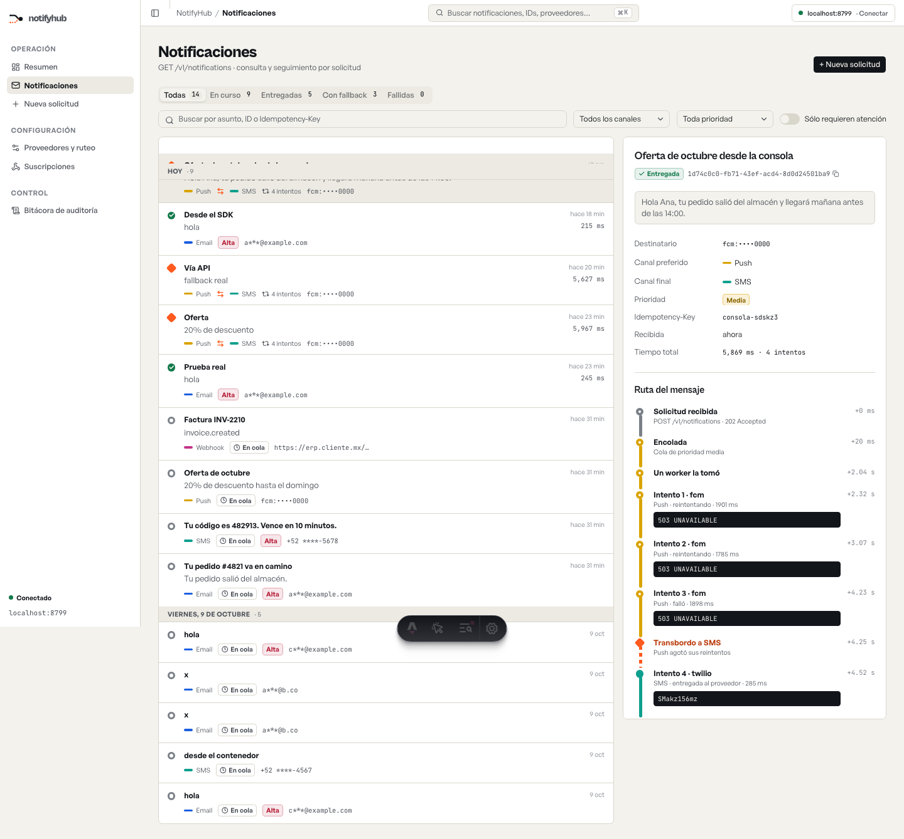

# @notifyhub/ui

Componentes React para mostrar notificaciones multicanal **con su ruta**: cada canal es una línea de metro, cada intento una estación y el fallback un transbordo naranja. Se conectan a la API de NotifyHub con [`@notifyhub/client`](../client) y no dependen de ningún framework de aplicación.



```bash
pnpm add @notifyhub/ui @notifyhub/client lucide-react
```

## Puesta en marcha (Tailwind v4)

En el CSS de tu aplicación:

```css
@import 'tailwindcss';
@import '@notifyhub/ui/styles.css'; /* tokens de diseño: colores, radios y tipografías */
@source '../node_modules/@notifyhub/ui/dist'; /* para que Tailwind vea las clases de los componentes */
```

Carga las tipografías en tu `<head>` (cada familia de Fontshare en su propia petición):

```html
<link rel="stylesheet" href="https://api.fontshare.com/v2/css?f[]=cabinet-grotesk@500,700,800&display=swap" />
<link rel="stylesheet" href="https://api.fontshare.com/v2/css?f[]=general-sans@400,500,600&display=swap" />
<link
  rel="stylesheet"
  href="https://fonts.googleapis.com/css2?family=JetBrains+Mono:wght@400;500&display=swap"
/>
```

## Ejemplo

```tsx
import { createNotifyHubClient } from '@notifyhub/client';
import {
  NotificationDetail,
  NotificationItem,
  NotifyHubProvider,
  useNotification,
  useNotifications,
} from '@notifyhub/ui';
import { useState } from 'react';

const client = createNotifyHubClient({ baseUrl: 'https://tu-api.workers.dev', apiKey: '…' });

function Inbox() {
  const { data } = useNotifications({ limit: 50 }, { intervalMs: 4000 }); // se actualiza sola
  const [id, setId] = useState<string | null>(null);
  const selected = data?.items.find((n) => n.id === id);
  const { data: detail, loading } = useNotification(id); // intentos e historial; deja de sondear al terminar

  return (
    <div className="grid grid-cols-2 gap-4">
      <div>
        {data?.items.map((n) => (
          <NotificationItem key={n.id} item={n} selected={n.id === id} onSelect={(x) => setId(x.id)} />
        ))}
      </div>
      {selected && <NotificationDetail item={selected} detail={detail} loading={loading} />}
    </div>
  );
}

export default () => (
  <NotifyHubProvider client={client}>
    <Inbox />
  </NotifyHubProvider>
);
```

## Qué incluye

| Pieza                                                                                     | Para qué                                                                 |
| ----------------------------------------------------------------------------------------- | ------------------------------------------------------------------------ |
| `NotificationItem`                                                                        | Fila: estación de estado, asunto, canal, transbordo, intentos y latencia |
| `NotificationDetail`                                                                      | Propiedades y **ruta del mensaje** con tiempos reales del servidor       |
| `RouteMap`                                                                                | Mapa de rutas por canal con los transbordos de fallback                  |
| `RoutePreview`                                                                            | Ruta prevista de un envío antes de mandarlo                              |
| `StatusBadge`, `StationDot`, `ChannelTag`, `PriorityBadge`                                | Piezas de estado y canal (siempre con icono y texto, no solo color)      |
| `Logo`, `LogoMark`                                                                        | Identidad de marca                                                       |
| `NotifyHubProvider`, `useNotifications`, `useNotification`, `useProviders`, `useAuditLog` | Datos con sondeo; se pausa con la pestaña oculta                         |
| `buildRoute`, `computeFlows`, `summarize`                                                 | Funciones puras: la ruta de un mensaje, el flujo por canal y los totales |

Los hooks aceptan cualquier objeto que cumpla `NotifyHubClient`, así que una aplicación puede pasar un cliente simulado para demostraciones sin servidor.

## Diseño

Los tokens y las reglas están en [`DESIGN.md`](../../DESIGN.md): papel y tinta, una línea de color por canal (Email azul, SMS verde azulado, Push dorado, Webhook magenta) y el naranja reservado al transbordo.

Licencia MIT.
